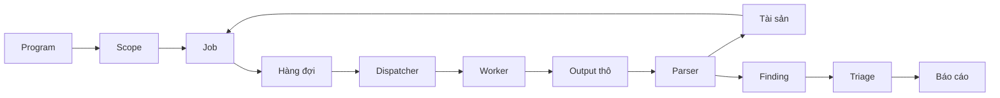
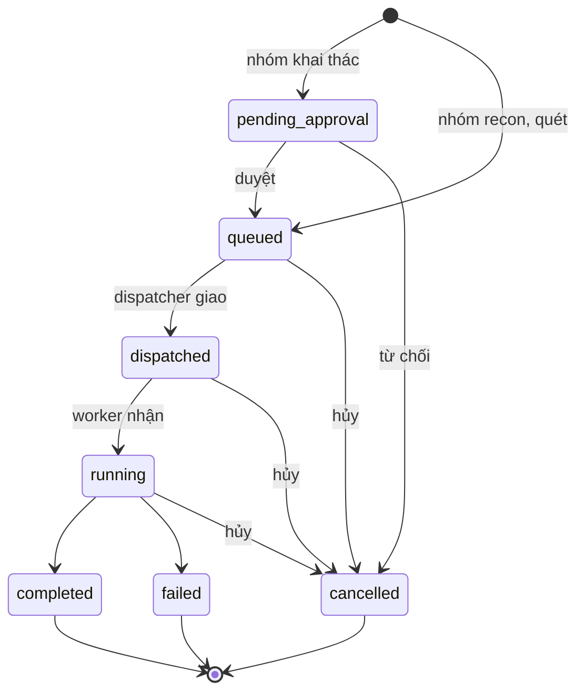

# Luồng nghiệp vụ

> Phiên bản: 1.2 · Ngày: 2026-11-05 · Trạng thái: 🔵 Chờ duyệt
> Mục 11: Luồng nghiệp vụ
> Liên quan: [overview.md](overview.md), [modules.md](modules.md), [system.md](system.md), [authorization.md](../security/authorization.md)

## 📌 Đây là gì

- Chuỗi nghiệp vụ từ program đến báo cáo: program, scope, job, output thô, tài sản, finding, triage, báo cáo.
- Quy tắc so khớp scope, vòng đời job, vòng đời finding.

## 🎯 Dùng để làm gì

- Mọi job chỉ chạy trên mục tiêu trong scope, kể cả khi scope đổi sau lúc tạo job (G5).
- Finding truy vết được về output thô làm bằng chứng cho báo cáo (G6, G8).

## ⏰ Dùng khi nào

- Viết nghiệp vụ của module `scope`, `job`, `dispatcher`, `parser`, `finding`, `report`. Thiết kế màn hình liên quan.
- Không dùng để tra tiến trình và kênh giao tiếp: xem [system.md](system.md).

## 📍 Ở đâu

- Module: [modules.md](modules.md). Quyền từng bước: [authorization.md](../security/authorization.md).
- Màn hình: S08, S09, S11 program và scope. S10 hàng đợi. S18 tool module. S03 đến S07 tài sản, screenshot. S20 finding.

## ⚙️ Làm như thế nào

### Luồng tổng

| Bước | Ai làm | Màn hình |
|---|---|---|
| Tạo program, khai báo scope rule | Admin, Superadmin | S08, S09, S11 |
| Tạo job thủ công trên mục tiêu hoặc tài sản | Admin, Superadmin, User trên program được gán | S03, S04, S05, S09, S18 |
| Tạo job theo lịch quét định kỳ của program | Tiến trình nền | S09 |
| Duyệt job nhóm khai thác | Admin, Superadmin, không phải người tạo job | S10 |
| Giao job, kiểm tra lại scope | Dispatcher | S10 |
| Chạy tool module, gửi output thô | Worker | S10 |
| Lưu output thô, parse | Backend API, tiến trình nền | |
| Triage finding | Admin, Superadmin, User trên program được gán | S20 |
| Tạo báo cáo | Admin, Superadmin, User trên program được gán | |

- Tạo job từ nhiều tài sản đã chọn trên S03, S04: chỉ khi mọi tài sản thuộc cùng một program, vì một job thuộc một program.

- Tài sản mới không tự sinh job. Job chỉ tạo thủ công hoặc theo lịch quét định kỳ. Tự sinh job: [roadmap.md](../roadmap.md).

### Kiểm tra scope

Mục tiêu hợp lệ khi khớp **ít nhất một** In-Scope và **không khớp** Out-of-Scope nào của program.

| Dạng scope rule | Khớp mục tiêu |
|---|---|
| Domain `example.com` | Đúng domain đó. Mục tiêu URL khớp khi host đúng domain đó |
| Wildcard `*.example.com` | Mọi subdomain mọi cấp: `a.example.com`, `a.b.example.com`. ❌ Không khớp `example.com`. Mục tiêu URL khớp khi host khớp |
| CIDR `198.51.100.0/24` | IP nằm trong dải. Mục tiêu CIDR khớp khi cả dải nằm trong dải của rule |
| URL `https://example.com/api/` | Mục tiêu URL có cùng scheme, host, cổng, và đường dẫn bắt đầu bằng đường dẫn của rule |

- Mục tiêu CIDR mà một phần dải khớp Out-of-Scope: không hợp lệ.
- Mục tiêu domain không so khớp với scope rule dạng CIDR. ReconOS không phân giải DNS để kiểm tra scope.
- Kiểm tra ở hai thời điểm:
  1. Khi tạo job. Mục tiêu không hợp lệ thì từ chối tạo job (G5).
  2. Khi dispatcher giao job. Mục tiêu không còn hợp lệ thì chuyển job sang `cancelled`, ghi lý do.
- Runner không kiểm tra scope vì worker không truy cập CSDL.

### Vòng đời job

| Trạng thái | Nghĩa |
|---|---|
| `pending_approval` | Job nhóm khai thác chờ duyệt. Dispatcher không giao |
| `queued` | Chờ dispatcher giao |
| `dispatched` | Dispatcher đã gửi task Celery, chưa có worker nhận |
| `running` | Worker đang chạy tool module |
| `completed` | Tool module chạy xong, output thô đã gửi về |
| `failed` | Tool module lỗi hoặc quá thời gian |
| `cancelled` | Bị từ chối duyệt, bị hủy, hoặc mục tiêu ra khỏi scope lúc giao |

- Lưu trữ program: không tạo job mới, lịch quét định kỳ ngừng, job `pending_approval`, `queued` chuyển `cancelled`. Job `dispatched`, `running` chạy tiếp đến xong. Dữ liệu giữ nguyên, chỉ đọc. Cách lưu trữ và xóa cứng: [database.md](../data/database.md).
- Tạm dừng program không phải trạng thái job. Dispatcher không giao job `queued` của program tạm dừng. Job `dispatched`, `running` chạy tiếp đến xong.
- Thử lại job `failed` hoặc `cancelled`: tạo job mới liên kết job cũ. Job cũ giữ nguyên trạng thái và output thô. Job mới được kiểm tra lại scope và đi lại luồng duyệt nếu thuộc nhóm khai thác.
- Ưu tiên, giới hạn đồng thời và tốc độ khi giao: [system.md](system.md).

### Chống xử lý trùng

- Worker báo nhận job qua Backend API. API chỉ chuyển `dispatched` sang `running`. Job ở trạng thái khác thì worker bỏ task.
- Upload output thô kèm job ID và tên file. Gửi lại cùng job ID và tên file không tạo bản trùng.
- Parser cập nhật hoặc tạo mới tài sản theo khóa tự nhiên, finding theo chuỗi khử trùng lặp. Parse lại cùng output thô không tạo bản trùng.
- Định dạng request: [external-services.md](../integrations/external-services.md).

### Tài sản

- Parser tạo hoặc cập nhật tài sản thuộc program của job.
- Parser vẫn lưu tài sản không khớp scope và đánh dấu ngoài scope. ❌ Không tạo job trên tài sản ngoài scope.
- Scope rule thay đổi: tính lại đánh dấu scope của tài sản trong program.
- Liên kết chéo tài sản, screenshot, finding, output thô: [database.md](../data/database.md).

### Vòng đời finding

| Trạng thái triage | Nghĩa |
|---|---|
| `new` | Parser vừa tạo, chưa xem |
| `confirmed` | Đã xác nhận là lỗ hổng thật |
| `false_positive` | Không phải lỗ hổng |
| `duplicate` | Trùng với finding khác đã có |
| `reported` | Đã đưa vào báo cáo nộp cho program |
| `resolved` | Program xác nhận đã sửa |

- Parser tạo finding mới ở `new`. Finding trùng chuỗi khử trùng lặp chỉ cập nhật thời điểm phát hiện gần nhất, giữ trạng thái triage.
- Người có quyền triage đổi trạng thái thủ công. Mỗi lần đổi ghi nhật ký thao tác.
- Finding giữ liên kết tới job và output thô nguồn.

### Báo cáo

1. Chọn finding `confirmed` của một program.
2. Tạo báo cáo trong ReconOS, đính kèm bằng chứng từ output thô.
3. Đánh dấu báo cáo đã nộp. Finding trong báo cáo chuyển sang `reported`.

- Gửi báo cáo lên nền tảng bug bounty nằm ngoài phạm vi: [overview.md](overview.md).
