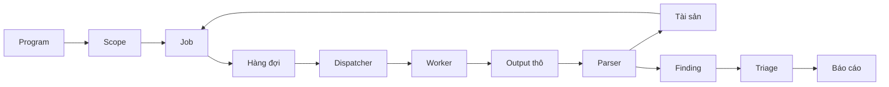
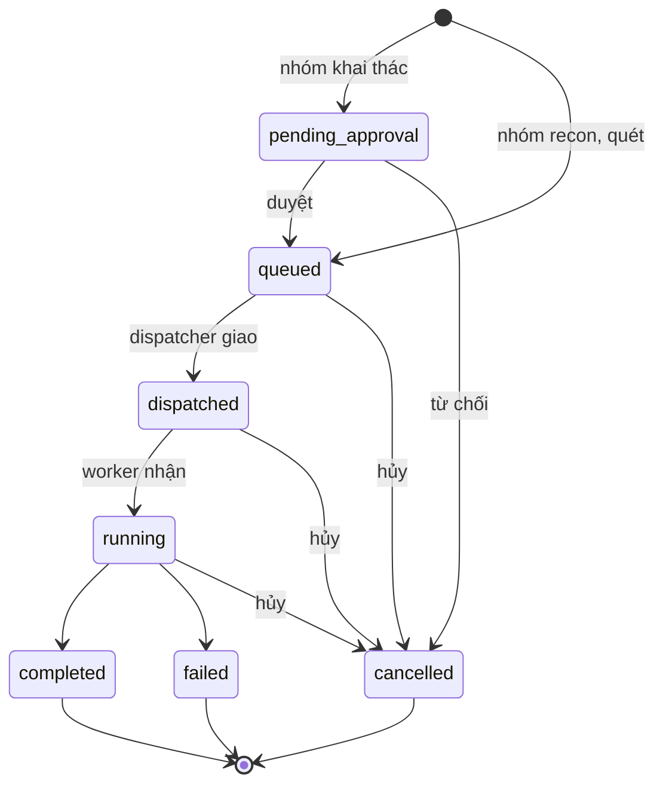

# Luồng nghiệp vụ

> Phiên bản: 1.10 · Ngày: 2026-11-13 · Trạng thái: 🔵 Chờ duyệt
> Mục 11: Luồng nghiệp vụ
> Liên quan: [overview.md](overview.md), [modules.md](modules.md), [system.md](system.md), [authorization.md](../security/authorization.md), [ADR xóa mềm](../decisions/adr-soft-delete.md)

## 📌 Đây là gì

- Chuỗi nghiệp vụ từ program đến báo cáo: program, scope, job, output thô, tài sản, finding, triage, báo cáo.
- Quy tắc so khớp scope, vòng đời job, vòng đời finding.

## 🎯 Dùng để làm gì

- Mọi job chỉ chạy trên mục tiêu trong scope, kể cả khi scope đổi sau lúc tạo job (G5).
- Finding truy vết được về output thô làm bằng chứng cho báo cáo (G6, G8).

## ⏰ Dùng khi nào

- Viết nghiệp vụ của module `scope`, `job`, `dispatcher`, `parser`, `finding`, `report`. Thiết kế màn hình liên quan.
- Không dùng để tra tiến trình và kênh giao tiếp: xem [system.md](system.md).

## 📍 Ở đâu

- Module: [modules.md](modules.md). Quyền từng bước: [authorization.md](../security/authorization.md).
- Màn hình: S08, S09, S11 program và scope. S10 hàng đợi. S18 tool module. S03 đến S07 tài sản, screenshot. S20 finding. S21 báo cáo.

## ⚙️ Làm như thế nào

### Luồng tổng

| Bước | Ai làm | Màn hình |
|---|---|---|
| Tạo program, khai báo scope rule | Admin, Superadmin | S08, S09, S11 |
| Tạo job thủ công trên mục tiêu hoặc tài sản | Admin, Superadmin, User trên program được gán | S03, S04, S05, S09, S18 |
| Tạo job theo lịch quét định kỳ của program | Tiến trình nền | S09 |
| Duyệt job nhóm khai thác | Admin, Superadmin, không phải người tạo job | S10 |
| Giao job, kiểm tra lại scope | Dispatcher | S10 |
| Chạy tool module, gửi output thô | Worker | S10 |
| Lưu output thô, parse | Backend API, tiến trình nền | |
| Triage finding | Admin, Superadmin, User trên program được gán | S20 |
| Tạo báo cáo | Admin, Superadmin, User trên program được gán | S20, S21 |

- Tạo job từ nhiều tài sản đã chọn trên S03, S04: chỉ khi mọi tài sản thuộc cùng một program, vì một job thuộc một program.

- Tài sản mới không tự sinh job. Job chỉ tạo thủ công hoặc theo lịch quét định kỳ. Tự sinh job: [roadmap.md](../roadmap.md).

### Kiểm tra scope

Mục tiêu hợp lệ khi khớp **ít nhất một** In-Scope và **không khớp** Out-of-Scope nào của program.

| Dạng scope rule | Khớp mục tiêu |
|---|---|
| Domain `example.com` | Đúng domain đó. Mục tiêu URL khớp khi host đúng domain đó |
| Wildcard `*.example.com` | Mọi subdomain mọi cấp: `a.example.com`, `a.b.example.com`. ❌ Không khớp `example.com`. Mục tiêu URL khớp khi host khớp |
| CIDR `198.51.100.0/24` | IP nằm trong dải. Mục tiêu CIDR khớp khi cả dải nằm trong dải của rule |
| URL `https://example.com/api/` | Mục tiêu URL có cùng scheme, host, cổng, và đường dẫn bắt đầu bằng đường dẫn của rule |

- Mục tiêu CIDR mà một phần dải khớp Out-of-Scope: không hợp lệ. Mục tiêu CIDR nằm vắt qua hai In-Scope CIDR, không nằm trọn trong rule nào: không hợp lệ.
- Mục tiêu domain không so khớp với scope rule dạng CIDR. ReconOS không phân giải DNS để kiểm tra scope.
- Mục tiêu URL có host là IP khớp scope rule CIDR chứa IP đó.
- Scope rule URL chỉ khớp mục tiêu URL. Mục tiêu domain, IP, CIDR không khớp scope rule URL, kể cả Out-of-Scope.
- Mục tiêu hợp lệ có một trong 4 dạng: domain, IP, CIDR, URL `http` hoặc `https`. Dạng khác bị từ chối, không đoán.

**Chuẩn hóa trước khi so khớp:** backend lưu scope rule và mục tiêu job ở dạng chuẩn hóa, đúng chuỗi đã kiểm tra.

| Thành phần | Quy tắc |
|---|---|
| Domain | Chữ thường, bỏ một dấu `.` cuối. Chỉ nhận ASCII: domain quốc tế nhập dạng punycode `xn--...`. Nhãn cuối toàn chữ số như `127.1`, `2130706433` bị từ chối vì trình phân giải đọc thành IP |
| IP, CIDR | IPv4-mapped IPv6 như `::ffff:198.51.100.7` so khớp như IPv4. CIDR có bit host như `198.51.100.7/24` bị từ chối. Từ chối IP kèm zone `%eth0` |
| URL | Scheme, host chữ thường. Cổng mặc định 80, 443 khi không ghi. Đường dẫn: giải mã ký tự không dành riêng như `%61`, bỏ đoạn `.` và `..`. Từ chối URL có tài khoản `user@`, đường dẫn có `\`, `%2F`, `%5C`. Bỏ qua query và fragment khi so khớp. Scope rule URL không được có query, fragment |

- Mã lỗi khi giá trị scope rule hoặc mục tiêu không đọc được: [api/architecture.md](../api/architecture.md).
- Scope rule đã lưu không đọc được, ví dụ dữ liệu cũ trước khi siết chuẩn hóa: In-Scope bị bỏ qua, Out-of-Scope làm program không nhận mục tiêu nào cho tới khi sửa rule.
- Program `archived`: scope rule chỉ đọc. Program `paused` vẫn sửa được scope rule.
- Kiểm tra ở hai thời điểm:
  1. Khi tạo job. Mục tiêu không hợp lệ thì từ chối tạo job (G5).
  2. Khi dispatcher giao job. Mục tiêu không còn hợp lệ thì chuyển job sang `cancelled`, ghi lý do.
- Runner không kiểm tra scope vì worker không truy cập CSDL.

### Vòng đời job

| Trạng thái | Nghĩa |
|---|---|
| `pending_approval` | Job nhóm khai thác chờ duyệt. Dispatcher không giao |
| `queued` | Chờ dispatcher giao |
| `dispatched` | Dispatcher đã gửi task Celery, chưa có worker nhận |
| `running` | Worker đang chạy tool module |
| `completed` | Tool module chạy xong, output thô đã gửi về |
| `failed` | Tool module lỗi hoặc quá thời gian |
| `cancelled` | Bị từ chối duyệt, bị hủy, hoặc mục tiêu ra khỏi scope lúc giao. Job đang `running` bị hủy giữ `finished_at` rỗng tới khi worker dừng công cụ, gửi output đã có và gọi finish |

- Lưu trữ program: không tạo job mới, lịch quét định kỳ ngừng, job `pending_approval`, `queued` chuyển `cancelled` ở lượt giao kế tiếp của dispatcher, `status_reason` là `Program archived.`. Job `dispatched`, `running` chạy tiếp đến xong. Dữ liệu giữ nguyên, chỉ đọc. Cách lưu trữ và xóa cứng: [database.md](../data/database.md).
- Tạm dừng program không phải trạng thái job. Dispatcher không giao job `queued` của program tạm dừng. Job `dispatched`, `running` chạy tiếp đến xong.
- Chuyển trạng thái program: tạm dừng `active` sang `paused`, tiếp tục `paused` sang `active`, lưu trữ `active` hoặc `paused` sang `archived`. Không bỏ lưu trữ được. Chuyển khác trả `409 conflict`.
- Program `archived` chỉ đọc: không sửa program, không thêm, sửa, xóa proxy. Gán, bỏ gán User vẫn được vì thao tác này quyết định ai đọc dữ liệu đã lưu trữ.
- Duyệt job `pending_approval`: job chuyển `queued`, ghi `approved_by`, `approved_at`, đánh thức dispatcher. Từ chối: job chuyển `cancelled`, `status_reason` là `Rejected by approver.`, ghi `finished_at`. Người duyệt hay từ chối ghi trong nhật ký thao tác `job_approved`, `job_rejected`. Job ở trạng thái khác trả `409 conflict`.
- Người tạo job không duyệt, không từ chối được job đó, kể cả Superadmin. Điều kiện `created_by` khác người duyệt nằm ngay trong câu `UPDATE`. Job do lịch sinh có `created_by` `NULL` nên Superadmin, Admin nào cũng duyệt được: nợ 70 trong [tech-debt.md](../tech-debt.md).
- Thử lại job `failed` hoặc `cancelled`: tạo job mới liên kết job cũ. Job cũ giữ nguyên trạng thái và output thô. Job mới được kiểm tra lại scope và đi lại luồng duyệt nếu thuộc nhóm khai thác.
- Ưu tiên, giới hạn đồng thời và tốc độ khi giao: [system.md](system.md).

### Lịch quét định kỳ

| Thao tác | Ai làm | Quy tắc |
|---|---|---|
| Tạo lịch | Admin, Superadmin trên S09 | Kiểm như tạo job: tool module bật, `params` khớp `param_schema`, mọi mục tiêu In-Scope (G5). Lưu mục tiêu dạng chuẩn. Tool module nhóm `exploit`: `422` mã `tool_module_not_schedulable`, vì job do Beat sinh không có người tạo để chặn tự duyệt. Program `archived`: `409`. `interval_minutes` từ 15 đến 525.600. Lần chạy đầu cách lúc tạo một chu kỳ |
| Sửa, bật, tắt, xóa lịch | Admin, Superadmin trên S09 | Không đổi tool module. Đổi `target`, `params`: kiểm lại như lúc tạo. Đổi chu kỳ hoặc bật lại: `next_run_at` tính lại từ lúc sửa. Xóa lịch: job đã sinh giữ lịch sử, `schedule_id` về `NULL`. Program `archived`: `409` |
| Chạy ngay một lịch | Admin, Superadmin trên S09 | Tạo một job như job từ API, `created_by` là người bấm. Không đổi `next_run_at`. Program không `active`: `409` |
| Chạy lịch đến hạn | Tiến trình nền | Chỉ lịch đang bật của program `active`. Job nhận `created_by` là `NULL`, `priority` là `normal`, `params` gộp `default_params` lúc chạy. Kiểm lại scope, tham số, tool module mỗi lần. Bị từ chối: không tạo job, ghi `audit_log` hành động `schedule_run_failed` kèm mã lỗi, vẫn dời `next_run_at`. Mốc bị lỡ, kể cả khi program tạm dừng, không chạy bù từng mốc: lượt chạy đầu sau khi tiếp tục tạo một job rồi dời tới mốc kế tiếp |

### Độ ưu tiên và điều khiển hàng đợi

| Thao tác | Màn hình | Kết quả |
|---|---|---|
| Chọn độ ưu tiên khi tạo job | S05, S09, S18 | `priority` là `low`, `normal` hoặc `high`. Mặc định `normal`. Job do `schedule` sinh nhận `normal` |
| Dispatch Now trên một job `queued` | S10 | Nâng `priority` lên `high`, đánh thức dispatcher. Job vẫn qua đủ bước kiểm tra khi giao |
| Dispatch All | S10 | Đánh thức dispatcher chạy ngay một lượt giao, không đổi `priority` |
| Cleanup | S10 | Chuyển mọi job `queued` của program `paused` hoặc `archived` sang `cancelled`, `status_reason` ghi lý do dọn hàng đợi |
| Retry Failed | S10 | Thử lại hàng loạt job `failed`, mỗi job theo quy tắc thử lại ở trên |

- Dispatcher chọn job `priority` cao trước, cùng mức thì job tạo trước giao trước.
- ❌ Dispatch Now, Dispatch All không bỏ qua duyệt job nhóm khai thác, giới hạn đồng thời, tốc độ, kiểm tra lại scope (G5).
- Tạo job cho nhiều tool module một lần: mỗi tool module một job, kiểm tra scope từng job. Một job không hợp lệ thì không job nào được tạo.

### Chống xử lý trùng

- Worker báo nhận job qua Backend API. API chỉ chuyển `dispatched` sang `running`. Job ở trạng thái khác thì worker bỏ task.
- Upload output thô kèm job ID và tên file. Gửi lại cùng job ID và tên file không tạo bản trùng.
- Parser cập nhật hoặc tạo mới tài sản theo khóa tự nhiên, finding theo chuỗi khử trùng lặp. Parse lại cùng output thô không tạo bản trùng.
- Định dạng request: [external-services.md](../integrations/external-services.md).

### Tài sản

- Parser tạo hoặc cập nhật tài sản thuộc program của job.
- Parser vẫn lưu tài sản không khớp scope và đánh dấu ngoài scope. ❌ Không tạo job trên tài sản ngoài scope.
- Scope rule thay đổi: tính lại đánh dấu scope của tài sản trong program.
- Liên kết chéo tài sản, screenshot, finding, output thô: [database.md](../data/database.md).
- Xóa domain, screenshot là xóa mềm: ẩn khỏi danh sách, output thô, finding, URL liên quan giữ nguyên. Parser gặp lại domain đã xóa thì không hiện lại: [ADR xóa mềm](../decisions/adr-soft-delete.md).
- Lần quét cổng sau trên một IP không thấy cổng đã có: parser ghi `service.closed_at`. Thấy lại cổng thì xóa giá trị này.

### Vòng đời finding

| Trạng thái triage | Nghĩa |
|---|---|
| `new` | Parser vừa tạo, chưa xem |
| `confirmed` | Đã xác nhận là lỗ hổng thật |
| `false_positive` | Không phải lỗ hổng |
| `duplicate` | Trùng với finding khác đã có |
| `reported` | Đã đưa vào báo cáo nộp cho program |
| `resolved` | Program xác nhận đã sửa |

- Parser tạo finding mới ở `new`. Finding trùng chuỗi khử trùng lặp chỉ cập nhật thời điểm phát hiện gần nhất, giữ trạng thái triage.
- Người có quyền triage đổi trạng thái thủ công theo bảng chuyển dưới. Mỗi lần đổi ghi nhật ký thao tác `finding_triaged` với trạng thái cũ, mới.
- Finding giữ liên kết tới job và output thô của lần phát hiện đầu.

| Từ | Sang được |
|---|---|
| `new` | `confirmed`, `false_positive`, `duplicate` |
| `confirmed` | `new`, `false_positive`, `duplicate`, `reported`, `resolved` |
| `false_positive` | `new`, `confirmed` |
| `duplicate` | `new`, `confirmed` |
| `reported` | `confirmed`, `resolved` |
| `resolved` | `confirmed` |

- Chuyển ngoài bảng: `409 conflict`, trạng thái giữ nguyên. Đổi sang chính trạng thái hiện tại: không đổi gì, không ghi nhật ký.
- `duplicate` cần `duplicate_of_id`: finding khác cùng program, không phải `duplicate`. Finding đang có finding khác trỏ tới không chuyển sang `duplicate` được. Rời `duplicate` thì xóa `duplicate_of_id`.
- Chỉ nộp báo cáo mới chuyển finding sang `reported`, theo mục Báo cáo. Triage bằng tay sang `reported`, kể cả hàng loạt: `409 conflict` mã `reported_by_report`. Dòng `confirmed` sang `reported` vẫn giữ trong bảng để chỉ bước chuyển. Lý do: mỗi finding `reported` truy được về báo cáo đã nộp (G6).
- Triage hàng loạt: tất cả hoặc không. Một finding chuyển sai bảng thì không finding nào đổi. Không nhận `duplicate`.
- Finding của program `archived` chỉ đọc: triage, gắn tag trả `409 conflict`.

### Báo cáo

1. Chọn finding `confirmed` của một program.
2. Tạo báo cáo trong ReconOS, đính kèm bằng chứng từ output thô.
3. Đánh dấu báo cáo đã nộp. Finding trong báo cáo chuyển sang `reported`.

| Trạng thái báo cáo | Nghĩa |
|---|---|
| `draft` | Đang soạn, sửa được mọi trường, xóa được |
| `submitted` | Đã nộp lên nền tảng bug bounty. Chỉ sửa được `platform_report_ref`, không xóa |

- Một báo cáo thuộc một program, gồm ít nhất một finding của program đó. Finding thêm vào phải đang `confirmed`. Một finding nằm được trong nhiều báo cáo nháp.
- Finding đã trong báo cáo nháp rồi rời `confirmed` vẫn nằm trong báo cáo. Nộp báo cáo khi còn finding không `confirmed`: `409 conflict`, không finding nào đổi. Người dùng xác nhận lại finding hoặc bỏ finding khỏi báo cáo.
- Nộp báo cáo: tất cả hoặc không. Mỗi finding chuyển sang `reported` ghi một dòng nhật ký `finding_triaged` kèm `report_id`. Báo cáo ghi `report_submitted`.
- Chỉ `draft` sang `submitted`, không chiều ngược lại.
- Bằng chứng là output thô tạo finding lần đầu. Báo cáo chỉ tham chiếu `raw_output`: tên file, SHA-256, đường tải qua Backend API. ❌ Không đọc, sửa, sao chép object output thô (G8).
- `platform_report_ref` nhập tay, thường biết sau khi nộp trên nền tảng, nên vẫn sửa được khi đã nộp.
- Báo cáo của program `archived` chỉ đọc.
- Nhật ký thao tác: `report_created`, `report_updated`, `report_deleted`, `report_submitted`.

- Gửi báo cáo lên nền tảng bug bounty nằm ngoài phạm vi: [overview.md](overview.md).
