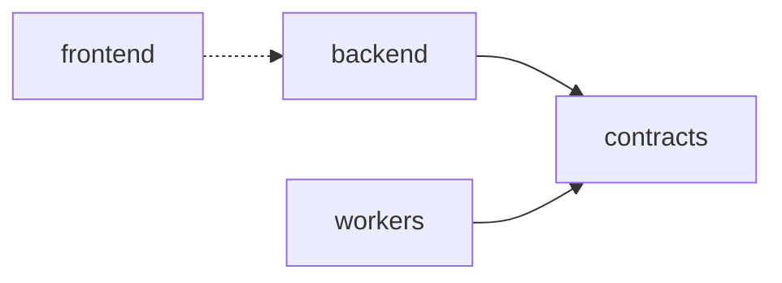
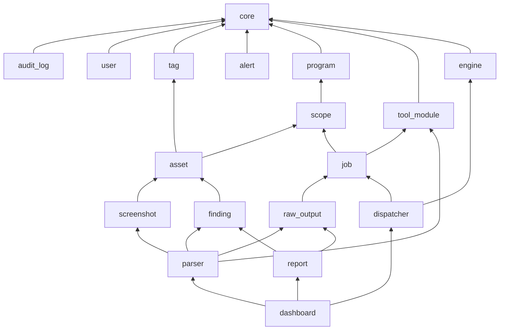

# Đồ thị phụ thuộc

> Phiên bản: 1.4 · Ngày: 2026-11-04 · Trạng thái: 🟢 Xong
> Mục 12: Đồ thị phụ thuộc
> Liên quan: [modules.md](modules.md), [directory-structure.md](directory-structure.md), [system.md](system.md)

## 📌 Đây là gì

- Chiều phụ thuộc được phép giữa các module backend và giữa các package trong repo.
- Phụ thuộc của từng phần vào hệ thống bên ngoài.

## 🎯 Dùng để làm gì

- Không có phụ thuộc vòng giữa module, tránh import vòng khi model có quan hệ chéo (G3).
- Thêm tool module không làm đổi đồ thị của lõi (G4).

## ⏰ Dùng khi nào

- Một module cần gọi module khác. Rà soát import giữa module.
- Không dùng để tra trách nhiệm của module: xem [modules.md](modules.md).

## 📍 Ở đâu

- Module backend: `backend/app/<module>/`. Package: `backend/`, `workers/`, `contracts/`, `frontend/`.
- Quy tắc import và cách kiểm tra: [design-patterns.md](../../.claude/rules/design-patterns.md).

## ⚙️ Làm như thế nào

### Package trong repo

- Mũi tên liền: import mã. Mũi tên đứt: gọi qua HTTP, WebSocket, không import.
- `contracts` không phụ thuộc package nào trong repo.

### Module backend

Module ở tầng trên được phép gọi `service.py` của module ở tầng dưới. ❌ Tầng dưới không gọi tầng trên. Cùng tầng không gọi nhau.

| Tầng | Module | Được phép gọi |
|---|---|---|
| 0 | `core` | Thư viện bên ngoài |
| 1 | `audit_log`, phần đọc | Tầng 0 |
| 2 | `user`, `tag`, `alert` | Tầng 0, 1 |
| 3 | `program`, `tool_module`, `engine` | Tầng 0 đến 2 |
| 4 | `scope` | Tầng 0 đến 3 |
| 5 | `asset`, `job` | Tầng 0 đến 4 |
| 6 | `raw_output`, `screenshot`, `finding` | Tầng 0 đến 5 |
| 7 | `parser`, `dispatcher`, `report` | Tầng 0 đến 6 |
| 8 | `dashboard` | Tầng 0 đến 7, chỉ đọc |

- `core` giữ bảng `audit_log` và hai hàm ghi nhật ký, vì dependency kiểm tra vai trò ở tầng 0 ghi lại yêu cầu bị từ chối. Module `audit_log` ở tầng 1 giữ phần đọc: schema, hàm liệt kê, router.
- Mọi module ghi nhật ký thao tác qua `core`, kiểm tra quyền qua `core`.
- `audit_log` không gọi `user`. Cột `audit_log.user_id` là UUID không có khóa ngoại nên phần đọc join bằng cột đó, không qua ràng buộc: [schema.md](../data/schema.md).
- `core` giữ bảng `user`, `user_session` và dependency xác thực, phân quyền, vì module ở mọi tầng đều cần. Nhờ vậy bảng tầng không có ngoại lệ nào.
- `job`, `parser`, `dispatcher` tạo cảnh báo qua `alert`. `alert` không gọi module nghiệp vụ. Khóa ngoại của `alert` tới `finding`, `job` khai báo bằng tên bảng.

- Sơ đồ chỉ vẽ phụ thuộc trực tiếp chính. Bảng tầng là quy tắc đầy đủ.

### Tầng dưới cần dữ liệu tầng trên

| Nhu cầu | Cách làm |
|---|---|
| Trang chi tiết tài sản hiển thị finding | Router của `finding` nhận tham số lọc theo tài sản. `asset` không gọi `finding` |
| Scope đổi, tính lại đánh dấu scope của tài sản | `scope` ghi thay đổi, `asset` đọc scope rule. Task tính lại thuộc `asset` |
| Output thô đã lưu cần parse | `raw_output` gửi task parse theo tên task. `parser` nhận task, không bị `raw_output` import |
| Finding liên kết output thô cùng tầng | Chỉ khóa ngoại tới bảng output thô. `finding` không gọi `raw_output` |
| Model cần khóa ngoại tới tầng trên | Khai báo khóa ngoại bằng tên bảng dạng chuỗi, không import model của tầng trên |
| Danh sách nhật ký thao tác cần tên tài khoản | `audit_log` join bảng `user` theo cột UUID `user_id`, cột này không có khóa ngoại. `audit_log` không gọi `user`. Response của đợt 2a chưa có trường tên tài khoản |

### Phụ thuộc bên ngoài

| Phần | Phụ thuộc |
|---|---|
| Backend API | PostgreSQL, Redis, MinIO |
| Dispatcher | PostgreSQL, Redis |
| Tiến trình nền | PostgreSQL, Redis, MinIO |
| Celery Beat | Redis |
| Worker | Redis, Backend API, công cụ trên máy worker, REST API của engine server |
| Frontend | Backend API |

- Phiên bản: [tech-stack.md](tech-stack.md). Công cụ và engine: [external-services.md](../integrations/external-services.md).
