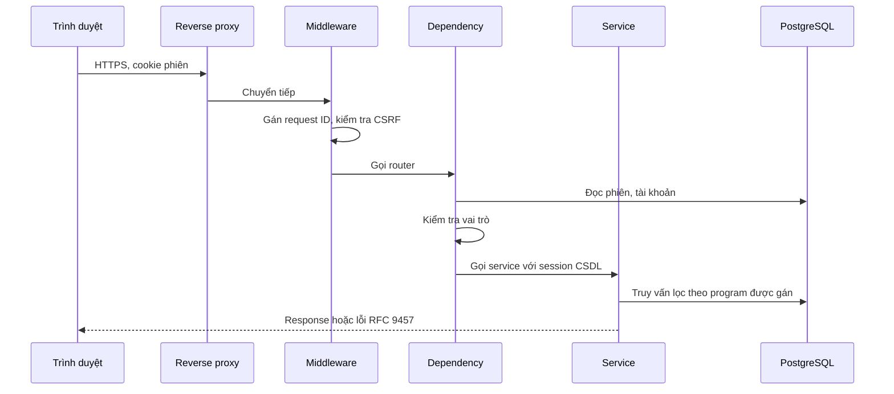
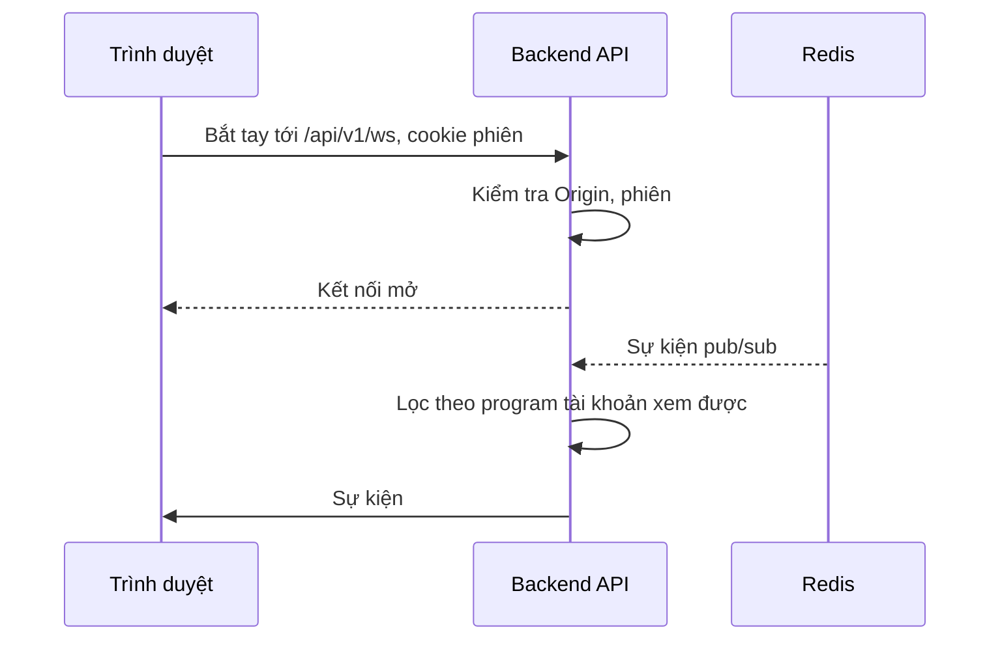

# Luồng request

> Phiên bản: 1.4 · Ngày: 2026-11-13 · Trạng thái: 🔵 Chờ duyệt
> Mục 6: Luồng request
> Liên quan: [authentication.md](../security/authentication.md), [authorization.md](../security/authorization.md), [api/architecture.md](../api/architecture.md), [system.md](system.md), [external-services.md](../integrations/external-services.md)

## 📌 Đây là gì

- Các bước trong Backend API mà request HTTP, kết nối WebSocket và request của worker lần lượt đi qua.
- Luồng tạo job từ request tới khi job vào hàng đợi.

## 🎯 Dùng để làm gì

- Mọi request qua đủ bước xác thực, chống CSRF (Cross-Site Request Forgery), phân quyền theo program trước khi chạm dữ liệu (G7).
- Job chỉ được tạo sau khi kiểm tra scope và tham số (G5).

## ⏰ Dùng khi nào

- Viết middleware, dependency, router mới. Điều tra request bị từ chối.
- Không dùng để tra luồng nghiệp vụ program đến báo cáo: xem [business-flow.md](business-flow.md).

## 📍 Ở đâu

- Middleware, dependency: `backend/app/core/`. Router, service: `backend/app/<module>/`.

## ⚙️ Làm như thế nào

### Request HTTP từ trình duyệt

| Bước | Thành phần | Không đạt thì |
|---|---|---|
| 1. Giải mã TLS, giới hạn kích thước body | Reverse proxy | `413` |
| 2. Lấy `request_id` từ `X-Request-ID` hoặc sinh mới, gắn vào log | Middleware | |
| 3. Kiểm tra `Origin`, `Sec-Fetch-Site` với request đổi dữ liệu | Middleware | `403 forbidden` |
| 4. Đọc cookie, tra giá trị băm của session ID, kiểm tra hết hạn, tài khoản bị khóa | Dependency xác thực | `401 unauthenticated` |
| 5. Kiểm tra vai trò có quyền gọi endpoint | Dependency phân quyền | `403 forbidden` |
| 6. Kiểm tra dữ liệu request theo schema Pydantic | FastAPI | `422 validation_error` |
| 7. Kiểm tra tài nguyên thuộc program được gán | Service | `404 not_found` |
| 8. Chạy nghiệp vụ trong một transaction, ghi nhật ký thao tác | Service | Rollback, lỗi theo loại |
| 9. Commit, publish sự kiện realtime sau commit. Service xếp sự kiện vào session, rollback thì bỏ | Dependency session | Redis lỗi: ghi log `warning`, request vẫn thành công |

- Lỗi ở bước nào cũng đi qua bộ xử lý lỗi chung: [error-handling.md](../../.claude/rules/error-handling.md).
- Request bị từ chối ở bước 3, 5, 7 được ghi nhật ký thao tác: [authorization.md](../security/authorization.md).
- Server component của Next.js gọi Backend API kèm cookie của trình duyệt, đi qua đúng các bước trên.

### Tạo job

1. Bước 1 đến 6 như trên.
2. Service của `job` khóa dòng program, kiểm tra program ở trạng thái `active`, sai thì `409`. Kiểm tra tool module đang bật.
3. Gộp `default_params` của tool module với `params`, kiểm tra theo schema của tool module trong `contracts/`. Kiểm tra `proxy_id` thuộc program và đang bật.
4. Kiểm tra từng mục tiêu với scope của program. Một mục tiêu không đạt thì từ chối cả job với `422 target_out_of_scope`.
5. Ghi job: nhóm khai thác vào `pending_approval`, nhóm khác vào `queued`. Gửi `NOTIFY` và xếp sự kiện `job.status_changed` trong cùng transaction.
6. Trả job vừa tạo. Dispatcher nhận thông báo và giao: [system.md](system.md).

### WebSocket

- `Origin` sai hoặc phiên không hợp lệ: đóng kết nối khi bắt tay, trước khi chấp nhận. Trình duyệt nhận `403`.
- Backend API kiểm tra lại phiên và program được xem trước mỗi sự kiện, và 30 giây một lần khi không có sự kiện. Lần kiểm tra này không commit nên không gia hạn phiên: kết nối đang mở không giữ phiên sống quá thời gian chờ.
- Phiên hết hạn hoặc bị thu hồi khi đang mở: server đóng kết nối với mã `4401`. Trình duyệt không kết nối lại, làm mới query đang mở, nhận `401` rồi chuyển về S01.
- Vai trò hoặc program được gán thay đổi: áp dụng cho sự kiện tiếp theo, không cần kết nối lại.
- Redis lỗi khi đang mở: server đóng với mã `1011`. Trình duyệt kết nối lại và làm mới toàn bộ query đang mở.

### Request từ worker

| Bước | Thành phần | Không đạt thì |
|---|---|---|
| 1. Giải mã TLS, giới hạn kích thước body theo cấu hình upload | Reverse proxy | `413` |
| 2. Tra giá trị băm của token, kiểm tra chưa thu hồi | Dependency xác thực worker | `401 unauthenticated` |
| 3. Chỉ cho phép đường dẫn `/api/v1/worker/` | Dependency xác thực worker | `403 forbidden` |
| 4. Kiểm tra job thuộc worker và trạng thái phù hợp | Service | `409 conflict` |
| 5. Xử lý `claim`, `heartbeat`, upload, `finish`, ghi log | Service | Lỗi theo loại |

- Không kiểm tra CSRF với request của worker vì không dùng cookie.
- Chi tiết từng endpoint: [external-services.md](../integrations/external-services.md).
