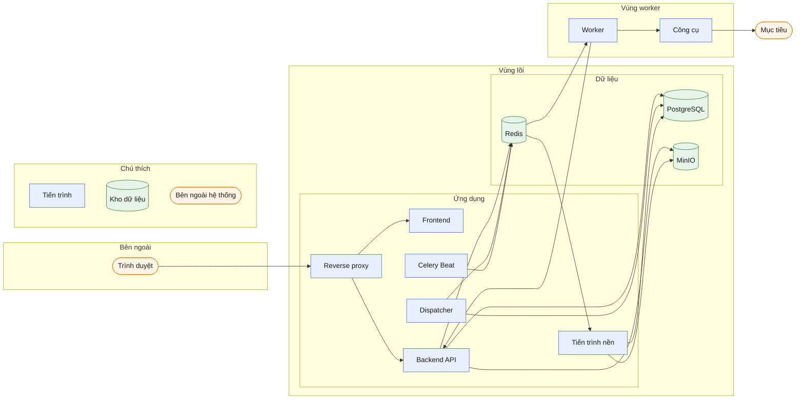
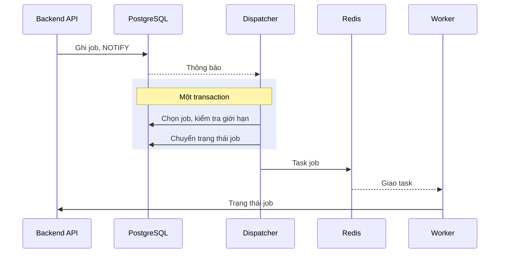
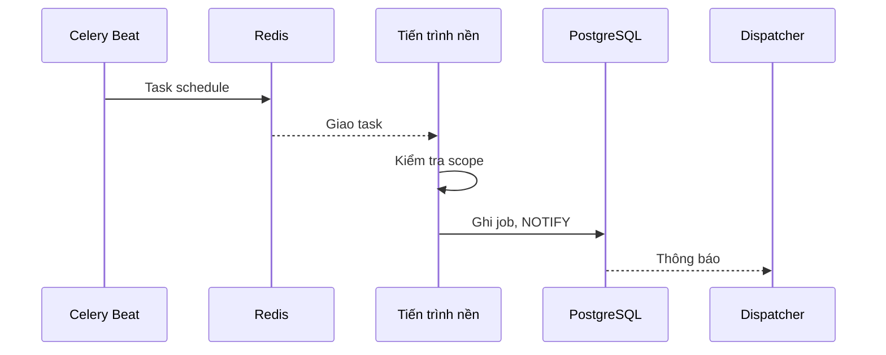
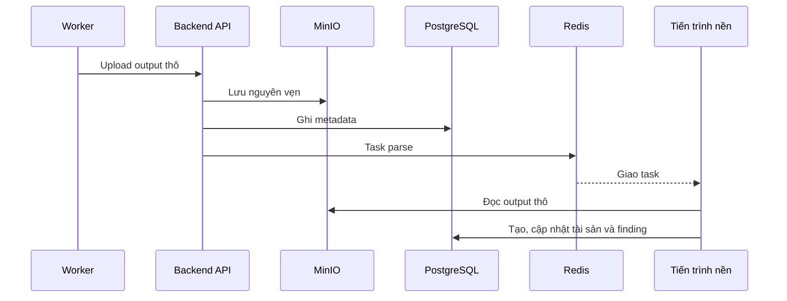
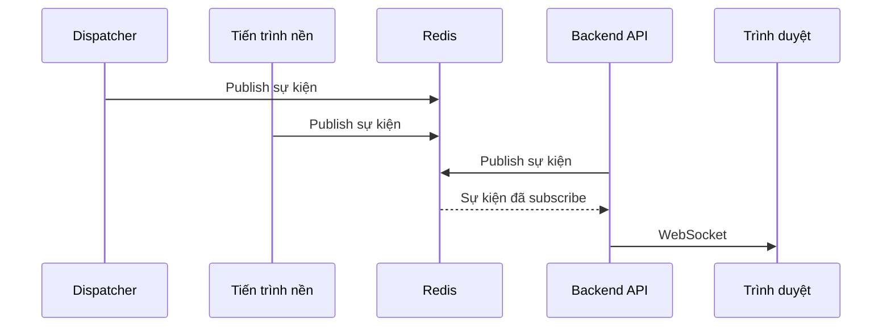

# Kiến trúc hệ thống

> Phiên bản: 1.3 · Ngày: 2026-11-12 · Trạng thái: 🔵 Chờ duyệt
> Mục 4: Kiến trúc hệ thống
> Liên quan: [overview.md](overview.md), [tech-stack.md](tech-stack.md), [directory-structure.md](directory-structure.md), [ADR chọn tech stack](../decisions/adr-tech-stack.md)

## 📌 Đây là gì

- Các tiến trình, kho dữ liệu của ReconOS và kênh giao tiếp giữa chúng.
- Ranh giới tin cậy và cơ chế của dispatcher, tiến trình nền.

## 🎯 Dùng để làm gì

- Cho thấy job đi từ hàng đợi qua worker phân tán (G4), backend lưu output thô trước khi parse (G8).
- Xác định ranh giới tin cậy làm nền cho xác thực, phân quyền, threat model (G7).

## ⏰ Dùng khi nào

- Thêm tiến trình, kho dữ liệu, kênh giao tiếp. Viết cấu hình triển khai.
- Không dùng để tra module nghiệp vụ trong backend: xem [modules.md](modules.md).

## 📍 Ở đâu

- Mã: `backend/app/`, `backend/app/dispatcher/`, `backend/app/parser/`, `workers/`, `contracts/`, `frontend/`.
- Màn hình theo dõi: S10 hàng đợi, S15 trạng thái hệ thống và công cụ.

## ⚙️ Làm như thế nào

### Sơ đồ tổng thể

- Mũi tên chỉ chiều dữ liệu chính. Kênh và nội dung từng mũi tên: mục Kênh giao tiếp.
- Vai trò từng ô: mục Tiến trình và Kho dữ liệu. Công cụ gồm cả engine.
- Luồng chi tiết vẽ riêng: giao job, job định kỳ, output thô và parse, realtime.

### Tiến trình

| Tiến trình | Chạy từ mã | Vai trò |
|---|---|---|
| Reverse proxy | `infras/` | Giải mã TLS, định tuyến tới frontend và Backend API |
| Backend API | `backend/` | REST, WebSocket, xác thực, phân quyền, kiểm tra scope khi tạo job (G5), nhận output thô và lưu vào MinIO (G8) |
| Dispatcher | `backend/app/dispatcher/` | Chọn job đến lượt, kiểm tra giới hạn, gửi task Celery cho worker. Một bản hoạt động, các bản khác chờ |
| Tiến trình nền | `backend/` | Celery chạy mã backend. Queue `parse`: đọc output thô đã lưu, tạo hoặc cập nhật tài sản và finding. Queue `schedule`: tạo job quét định kỳ |
| Celery Beat | `backend/` | Gửi task vào queue `schedule` theo lịch. Không tạo job, không giao job |
| Worker | `workers/` | Nhận task job, chạy công cụ hoặc engine qua runner, gửi output thô về Backend API. Một đến nhiều máy |
| Frontend | `frontend/` | Render giao diện, gọi API và WebSocket của backend |

- Tiến trình nền chạy mã backend, không phải worker. ❌ Không chạy parser trên máy worker (G8).
- Worker chỉ nghe queue của job. Tiến trình nền chỉ nghe queue `parse` và `schedule`.
- Job định kỳ tạo qua service của module job, kiểm tra scope như job tạo từ API (G5).
- Sản phẩm reverse proxy, lệnh chạy từng tiến trình: [deployment.md](../ops/deployment.md). Cấu hình: [configuration.md](../ops/configuration.md).
- Số bản của từng tiến trình khi mở rộng: [scalability.md](../ops/scalability.md).

### Kho dữ liệu

| Kho | Chứa | Ai ghi |
|---|---|---|
| PostgreSQL | Program, scope, tài sản, job và trạng thái job, finding, metadata và khóa object của output thô, tài khoản, nhật ký thao tác | Backend API, dispatcher, tiến trình nền |
| PostgreSQL log | Log ứng dụng của mọi tiến trình, CSDL `reconos_log` | Backend API, dispatcher, tiến trình nền, Celery Beat. Log worker ghi qua Backend API |
| Redis | Broker Celery: queue job, queue `parse`, queue `schedule`. Kênh pub/sub sự kiện realtime | Backend API, dispatcher, tiến trình nền, Celery Beat |
| MinIO | Nội dung output thô, gồm cả file ảnh của screenshot | Chỉ Backend API. Worker không truy cập MinIO |

- Worker không truy cập PostgreSQL. ReconOS không đọc CSDL của công cụ hay engine (G1).
- Không dùng Celery result backend: [tech-stack.md](tech-stack.md).
- Schema: [database.md](../data/database.md).

### Kênh giao tiếp

| Từ | Tới | Kênh | Nội dung |
|---|---|---|---|
| Trình duyệt | Frontend, Backend API | HTTPS, WSS qua reverse proxy | Trang, REST, sự kiện realtime |
| Backend API, tiến trình nền | Dispatcher | PostgreSQL `NOTIFY` | Báo có job mới, job vừa xong, thay đổi tạm dừng hoặc duyệt, đổi độ ưu tiên, yêu cầu giao ngay |
| Dispatcher | Worker | Task Celery qua Redis | Tham số job theo contract |
| Worker | Backend API | HTTPS | Trạng thái job, upload nội dung output thô theo contract |
| Backend API | Tiến trình nền | Task Celery qua Redis, queue `parse` | Định danh output thô cần parse |
| Celery Beat | Tiến trình nền | Task Celery qua Redis, queue `schedule` | Lịch quét đến hạn |
| Mọi tiến trình lõi | Backend API | Redis pub/sub | Sự kiện đổi trạng thái để đẩy qua WebSocket |

- Contract worker ↔ backend, gồm endpoint và định dạng upload output thô: [external-services.md](../integrations/external-services.md).
- Endpoint và định dạng API: [api/architecture.md](../api/architecture.md).

### Ranh giới tin cậy

| Vùng | Thành phần | Tin cậy |
|---|---|---|
| Bên ngoài | Trình duyệt | ❌ Không tin. Backend xác thực và phân quyền mọi request |
| Vùng lõi | Reverse proxy, frontend, Backend API, dispatcher, tiến trình nền, Celery Beat, PostgreSQL, Redis, MinIO | Tin cậy lẫn nhau trong mạng nội bộ |
| Vùng worker | Worker, công cụ, engine | ⚠️ Tin cậy một phần. Worker tiếp xúc mục tiêu, output thô có thể chứa dữ liệu độc hại |
| Mục tiêu | Hệ thống của program | ❌ Không tin |

- Worker gọi Backend API bằng thông tin xác thực riêng: [authentication.md](../security/authentication.md).
- Parser xử lý output thô như dữ liệu không tin cậy. Mối đe dọa và biện pháp: [threat-model.md](../security/threat-model.md).

### Cơ chế dispatcher

1. Backend API hoặc tiến trình nền ghi job vào PostgreSQL và gửi `NOTIFY` trong cùng transaction. Transaction rollback thì không có thông báo.
2. Dispatcher `LISTEN` để phản ứng ngay. Dispatcher cũng quét định kỳ để không bỏ sót khi mất kết nối. Chu kỳ quét: [configuration.md](../ops/configuration.md). Dispatch Now, Dispatch All trên S10 chỉ gửi `NOTIFY`, dispatcher chạy lượt giao như bình thường: [business-flow.md](business-flow.md).
3. Mỗi lượt giao job:
   - Bỏ qua job chờ duyệt và job của program tạm dừng.
   - Chọn job `priority` cao trước, cùng mức thì job tạo trước.
   - Kiểm tra giới hạn số job đồng thời và tốc độ theo công cụ, program, mục tiêu.
   - Đếm job đang chạy và chuyển trạng thái job trong cùng một transaction PostgreSQL. Không vượt giới hạn khi nhiều sự kiện đến cùng lúc.
   - Gửi task Celery cho worker.
4. Nhiều bản dispatcher có thể chạy. Chỉ bản giữ PostgreSQL advisory lock được giao job. Bản giữ lock dừng thì kết nối đóng, lock được nhả, bản chờ chiếm lock và tiếp tục.
5. Dispatcher gửi heartbeat. Trạng thái hiển thị ở S10, S15.

- Trạng thái job và chuyển trạng thái: [business-flow.md](business-flow.md).

### Luồng job định kỳ

- Từ bước Thông báo, job định kỳ đi tiếp như job tạo từ API.

### Luồng output thô và parse

1. Worker chạy công cụ, upload output thô lên Backend API theo contract.
2. Backend API lưu nguyên vẹn nội dung vào MinIO, ghi metadata vào PostgreSQL.
3. Backend API gửi task parse vào queue `parse`. Công cụ chưa có parser thì bỏ qua bước này. Output thô vẫn tra cứu và tải về được (G8).
4. Tiến trình nền đọc output thô từ MinIO, chọn parser qua `registry.py`, tạo hoặc cập nhật tài sản và finding.
5. Task `parse` lỗi thử lại tối đa 3 lần, backoff theo cấp số nhân. Hết lượt thử: `parse_status = failed`, ghi `parse_error`.
6. Parse lỗi không làm mất output thô. Parse lại được từ output thô đã lưu.

- gowitness đi theo luồng này như mọi công cụ: worker gửi file kết quả và ảnh, parser tạo screenshot. ReconOS không dùng CSDL riêng của gowitness.
- Quy tắc viết mã xử lý lỗi: [error-handling.md](../../.claude/rules/error-handling.md).

### Realtime

1. Tiến trình nào đổi trạng thái thì publish sự kiện lên Redis pub/sub: job đổi trạng thái, finding mới, heartbeat.
2. Backend API subscribe, đẩy sự kiện tới trình duyệt qua WebSocket theo quyền của tài khoản.
3. Frontend cập nhật dữ liệu bằng TanStack Query.

