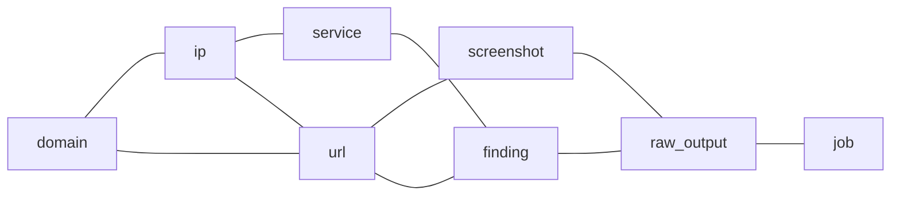

# Cơ sở dữ liệu

> Phiên bản: 1.4 · Ngày: 2026-11-12 · Trạng thái: 🔵 Chờ duyệt
> Mục 9: Cơ sở dữ liệu
> Liên quan: [schema.md](schema.md), [erd.mermaid](erd.mermaid), [business-flow.md](../architecture/business-flow.md), [system.md](../architecture/system.md), [ADR tự xây CSDL riêng](../decisions/adr-own-database.md), [ADR xóa mềm](../decisions/adr-soft-delete.md)

## 📌 Đây là gì

- Quy ước và quy tắc lưu dữ liệu của ReconOS trong PostgreSQL và MinIO.
- Gồm cách lưu output thô, liên kết chéo tài sản, khử trùng lặp, xóa và lưu trữ, index, migration. Mô tả bảng: [schema.md](schema.md). Cột và quan hệ: [erd.mermaid](erd.mermaid).

## 🎯 Dùng để làm gì

- ReconOS tự quản lý schema, không phụ thuộc CSDL của BBRF hay engine (G1).
- Liên kết chéo domain, IP, URL, service, screenshot, finding, output thô trong một CSDL (G3).
- Output thô lưu nguyên vẹn trước khi parse, tra cứu và tải về được (G8).

## ⏰ Dùng khi nào

- Thêm bảng, cột, index, migration. Viết parser ghi tài sản và finding. Viết thao tác xóa dữ liệu.
- Không dùng để tra cột của từng bảng: xem [schema.md](schema.md).

## 📍 Ở đâu

- PostgreSQL: CSDL chính và CSDL log `reconos_log`. MinIO: nội dung output thô. Vai trò từng kho: [system.md](../architecture/system.md).
- Model: `backend/app/<module>/models.py`. Migration Alembic: `backend/migrations/`. Client MinIO: `backend/app/core/`.

## ⚙️ Làm như thế nào

### Quy ước

| Mục | Quy ước |
|---|---|
| Tên bảng, cột | snake_case, số ít, theo cột Tên trong mã của [glossary](../appendix/glossary.md) |
| Khóa chính | `id uuid`, mặc định `uuidv7()` của PostgreSQL. Bảng nối dùng khóa chính ghép |
| Khóa ngoại | `<bảng>_id`. Cột người thực hiện: `created_by`, `updated_by`, `approved_by`, `triaged_by`, `assigned_by` |
| Thời gian | `timestamptz`, lưu UTC. Cột kết thúc bằng `_at` |
| Giá trị liệt kê | `text` kèm ràng buộc `CHECK`. ❌ Không dùng kiểu `ENUM` của PostgreSQL |
| Cờ | `bool`, tên bắt đầu bằng `is_` hoặc là tính từ như `in_scope` |
| Dữ liệu bán cấu trúc | `jsonb`: tham số job, chi tiết finding, diff, metadata HTTP |
| Thông tin xác thực | `bytea`, tên cột kết thúc bằng `_encrypted` |
| Dữ liệu thuộc program | Có cột `program_id` để lọc theo program được gán (G7) |

- `user` là từ khóa của PostgreSQL. SQLAlchemy tự đặt tên bảng này trong dấu nháy kép. SQL viết tay phải ghi `"user"`.
- Đổi giá trị liệt kê: migration sửa ràng buộc `CHECK`.

### Liên kết chéo

- Mỗi tài sản, finding, screenshot truy được về job và output thô nguồn: qua `asset_event`, `finding.raw_output_id`, `screenshot.raw_output_id` (G3, G6).

### Lưu output thô

1. Worker upload file kèm job ID và tên file qua Backend API.
2. Backend API ghi nguyên vẹn nội dung vào MinIO, tính SHA-256 khi ghi.
3. Backend API ghi dòng `raw_output` với `parse_status = pending` trong cùng request.
4. Tool module có parser: Backend API gửi task `parse`, tiến trình nền cập nhật `parse_status` thành `parsed` hoặc `failed`. Không có parser: Backend API đặt `parse_status = no_parser`, không gửi task.

| Mục | Quy tắc |
|---|---|
| Bucket | Một bucket cho output thô của mọi program |
| Khóa object | `<program_id>/<job_id>/<filename>` |
| Tên file | Do runner đặt, duy nhất trong một job. ❌ Không chứa `/` hoặc `..` |
| Upload lại | Cùng `job_id` và `filename`: không tạo dòng mới, không ghi đè nội dung đã lưu |
| Thời hạn giữ | Vĩnh viễn. Chỉ mất khi xóa cứng program |
| Parse lại | Đặt `parse_status = pending`, gửi lại task `parse`. Nội dung trong MinIO không đổi |

- ❌ Parser không sửa, không xóa object output thô.
- Screenshot: file ảnh là output thô của job gowitness. `screenshot` chỉ lưu metadata và trỏ tới `raw_output`.

### Liên kết tới tài sản

Bảng gắn với một tài sản bất kỳ có 4 cột `domain_id`, `ip_id`, `url_id`, `service_id`. Áp dụng cho `finding`, `asset_tag`, `asset_event`.

- Ràng buộc `CHECK (num_nonnulls(domain_id, ip_id, url_id, service_id) = 1)`: đúng một cột có giá trị.
- Mỗi cột là khóa ngoại thật tới bảng tài sản tương ứng.
- Mỗi cột có index riêng, lọc theo điều kiện cột khác `NULL`.

### Upsert và khử trùng lặp

- Parser ghi tài sản bằng `INSERT ... ON CONFLICT` theo khóa tự nhiên trong [schema.md](schema.md). Trùng thì cập nhật cột mô tả và `last_seen_at`.
- Tài sản mới hoặc đổi cột mô tả: ghi `asset_event` loại `discovered` hoặc `changed`, kèm `job_id`, `raw_output_id`, `diff`.
- Tài sản thấy lại không đổi: chỉ cập nhật `last_seen_at`, không ghi `asset_event`.
- `dedup_key` do parser của từng tool module tính, bắt đầu bằng tên tool module. 💡 Ví dụ: nuclei dùng `template-id` và `matched-at`.
- Finding trùng `program_id` và `dedup_key`: cập nhật `last_seen_at`, giữ `triage_status`. Vòng đời finding: [business-flow.md](../architecture/business-flow.md).
- `url` chuẩn hóa trước khi tính `url_hash`: scheme và host viết thường, bỏ cổng mặc định, bỏ fragment.

### Đánh dấu scope

- `in_scope` của tài sản tính khi parser ghi, theo quy tắc so khớp trong [business-flow.md](../architecture/business-flow.md).
- Scope rule đổi: task của module `asset` tính lại `in_scope` cho mọi tài sản của program.
- `in_scope` của IP, service tính theo địa chỉ IP. `in_scope` của URL tính theo host, so với scope rule loại URL, domain, wildcard.

### Thông tin xác thực

- Cột thông tin xác thực: `proxy.url_encrypted`, `engine.api_key_encrypted`, `engine_variable.value_encrypted`.
- Backend mã hóa trước khi ghi, giải mã khi gửi cho worker hoặc engine. Khóa mã hóa và thuật toán: [security.md](../../.claude/rules/security.md).
- Mật khẩu, session ID, token worker chỉ lưu giá trị băm: [authentication.md](../security/authentication.md).
- ❌ API không trả cột thông tin xác thực. UI chỉ hiển thị giá trị đã che (G7).
- ❌ Không ghi thông tin xác thực vào `audit_log.detail`, `asset_event.diff`, `job.params`. Khi đổi thông tin xác thực, nhật ký thao tác chỉ ghi tên cột đã đổi.

### Lưu trữ và xóa

| Đối tượng | Cách xóa |
|---|---|
| Program | Lưu trữ: `status = archived`, ghi `archived_at`. Chỉ Superadmin xóa cứng được |
| Dữ liệu của program đã lưu trữ | Giữ nguyên, chỉ đọc. Không tạo job, `schedule` không chạy |
| Xóa cứng program | Xóa dây chuyền mọi dòng có `program_id`, xóa object MinIO theo tiền tố `<program_id>/`. `audit_log.program_id` đặt `NULL` |
| Tài khoản | Khóa, hoặc xóa mềm bằng `deleted_at`. Giữ liên kết người thực hiện |
| Token worker | Không xóa, ghi `revoked_at` |
| Scope rule, tag, proxy, `schedule` | Xóa cứng, ghi nhật ký thao tác |
| Domain, screenshot | Xóa mềm bằng `deleted_at`, ghi nhật ký thao tác. Output thô, finding, URL liên quan giữ nguyên |
| `saved_filter` | Chủ sở hữu xóa cứng |
| IP, URL, service, finding, output thô, job | Không xóa riêng lẻ. Chỉ mất khi xóa cứng program |
| `audit_log` | Chỉ thêm. ❌ Không sửa, không xóa |

- Xóa mềm: [ADR xóa mềm](../decisions/adr-soft-delete.md).
- Khóa ngoại tới `program` dùng `ON DELETE CASCADE`. Khóa ngoại khác dùng `RESTRICT` mặc định.
- Xóa cứng chạy trong tiến trình nền: xóa dòng trong PostgreSQL trước, xóa object MinIO sau. Lỗi xóa object thì thử lại, không khôi phục dòng đã xóa.

### CSDL log

- Log ứng dụng lưu ở CSDL `reconos_log` riêng, tách khỏi CSDL chính. Bảng: [schema.md](schema.md).
- Mọi tiến trình ghi log ra stdout. Backend API, dispatcher, tiến trình nền, Celery Beat ghi thêm vào `reconos_log` từ cấp `info` trở lên.
- Worker không truy cập CSDL, gửi log theo lô qua `POST /api/v1/worker/logs`, Backend API ghi vào `reconos_log`: [external-services.md](../integrations/external-services.md).
- Thời hạn giữ: `log_retention_days`.
- `app_log` phân vùng theo ngày. Tiến trình nền tạo phân vùng trước và xóa phân vùng quá thời hạn giữ: [configuration.md](../ops/configuration.md).
- Superadmin xóa log trên S15 theo ngày: xóa mọi phân vùng `app_log` của các ngày trước ngày chọn. Không xóa phân vùng của ngày hiện tại. Nhật ký thao tác ghi người xóa và ngày chọn.
- Sao lưu `reconos_log` riêng, tách khỏi CSDL chính.

### Index chính

| Bảng | Index | Phục vụ |
|---|---|---|
| `job` | `status`, `priority`, `created_at`, điều kiện `status = queued` | Dispatcher chọn job đến lượt |
| `job` | GIN trên `target` | Tab Scan History trên S05: job có tài sản trong mục tiêu |
| `job` | `program_id`, `created_at` | S10 lọc theo program |
| `domain`, `ip`, `url`, `service` | `program_id`, `last_seen_at` | S03, S04 lọc và sắp xếp |
| `finding` | `program_id`, `triage_status`, `severity` | S20 lọc |
| `asset_event` | `program_id`, `created_at` | Dòng hoạt động trên S02, S05 |
| `alert` | `program_id`, `created_at` | Chuông thông báo |
| `audit_log` | `created_at`, `id` | Tra nhật ký thao tác, phân trang keyset |
| `audit_log` | `user_id`, `created_at` | Tra nhật ký thao tác theo tài khoản |
| `audit_log` | `action` | Lọc nhật ký theo tên thao tác |
| `login_attempt` | `username`, `attempted_at` | Đếm lần đăng nhập sai của tài khoản trong cửa sổ đếm |
| `login_attempt` | `ip_address`, `attempted_at` | Đếm lần đăng nhập sai của địa chỉ IP trong cửa sổ đếm |
| `app_log` | `job_id`, `logged_at` | Log của job trên S10 |
| `app_log` | `level`, `logged_at` | Log lỗi trên S15 |

- Index cho cột liên kết tài sản: mục Liên kết tới tài sản.
- ❌ Không phân vùng bảng ở bản đầu. Bảng tăng nhanh và ngưỡng phân vùng: [scalability.md](../ops/scalability.md).

### Migration

- Mọi thay đổi schema qua migration Alembic. ❌ Không sửa schema bằng tay trên CSDL.
- Sinh bằng `alembic revision --autogenerate`, đọc lại trước khi commit: autogenerate không phát hiện cột đổi tên và thay đổi ràng buộc `CHECK`.
- Đặt tên ràng buộc qua `naming_convention` của `MetaData`.
- ❌ Không sửa migration đã chạy trên môi trường dùng chung. Sửa bằng migration mới.
- Mỗi tool module có một dòng `tool_module`, thêm bằng migration dữ liệu khi thêm tool module.
- Thứ tự chạy migration khi triển khai: [deployment.md](../ops/deployment.md).
