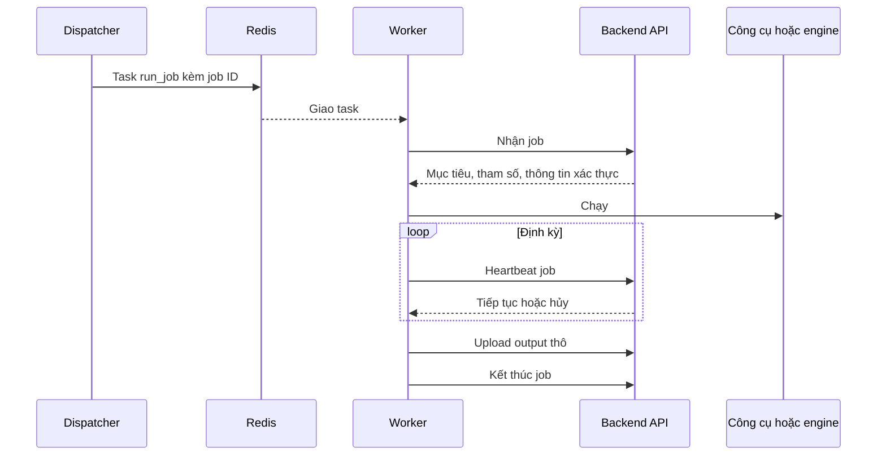

# Dịch vụ bên ngoài

> Phiên bản: 1.4 · Ngày: 2026-11-12 · Trạng thái: 🔵 Chờ duyệt
> Mục 13: Dịch vụ bên ngoài
> Liên quan: [modules.md](../architecture/modules.md), [system.md](../architecture/system.md), [database.md](../data/database.md), [authentication.md](../security/authentication.md), [schema.md](../data/schema.md), [tech-debt.md](../tech-debt.md)

## 📌 Đây là gì

- Contract worker ↔ backend: task Celery, endpoint worker gọi, cách upload output thô, heartbeat, hủy job.
- Cách runner gọi từng công cụ và engine, output thô mỗi tool module tạo ra và parser đọc gì từ đó.

## 🎯 Dùng để làm gì

- Mọi công cụ và engine đưa dữ liệu vào ReconOS qua một đường duy nhất: output thô (G1, G8).
- Thêm tool module chỉ cần thêm runner và parser theo cùng contract (G4).
- Thông tin xác thực không nằm trong Redis, worker chỉ nhận job đã kiểm tra scope (G5, G7).

## ⏰ Dùng khi nào

- Viết runner, parser, endpoint của contract worker. Thêm tool module. Cài engine server.
- Không dùng để tra API cho frontend: xem [api/architecture.md](../api/architecture.md).

## 📍 Ở đâu

- Model contract: `contracts/`. Runner: `workers/worker/runners/`. Parser: `backend/app/parser/`.
- Endpoint contract worker: `/api/v1/worker/`, chi tiết trong [openapi.yaml](../api/openapi.yaml). Cấu hình engine: S16, S17.

## ⚙️ Làm như thế nào

### Luồng một job trên worker

### Task Celery

| Mục | Quy định |
|---|---|
| Tên task | `worker.run_job` |
| Tham số | Chỉ `job_id`. ❌ Không gửi mục tiêu, tham số, thông tin xác thực qua Redis |
| Queue | `job.<tool module>`, ví dụ `job.nuclei`, `job.osmedeus-general` |
| Worker nghe | Các queue của tool module cài trên máy đó, khai báo trong cấu hình worker |
| Xác nhận | `acks_late`, mỗi lần nhận một task. Worker dừng đột ngột thì Celery giao lại task |
| Serializer | JSON. ❌ Không dùng pickle |

- Dispatcher gửi task vào queue theo `tool_module.name` của job.
- Model task: `contracts/`. Backend và workers kiểm tra cùng model.

### Endpoint của contract worker

Mọi endpoint dùng token worker trong header `Authorization: Bearer`: [authentication.md](../security/authentication.md).

| Endpoint | Việc | Kết quả |
|---|---|---|
| `POST /api/v1/worker/heartbeat` | Báo worker còn hoạt động, kèm `tool_modules`, `tools`: mỗi phần tử `name`, `version` của công cụ đã cài, `cpu_percent` | Cập nhật `worker.last_heartbeat_at`, `worker.tool_modules`, `worker.tool_versions`, `worker.cpu_percent` |
| `POST /api/v1/worker/jobs/{job_id}/claim` | Nhận job | Job `dispatched` chuyển `running`, trả đặc tả job. Trạng thái khác: `409`, worker bỏ task |
| `POST /api/v1/worker/jobs/{job_id}/heartbeat` | Báo job còn chạy | `continue` hoặc `cancel` |
| `PUT /api/v1/worker/jobs/{job_id}/raw-outputs/{filename}` | Upload một file output thô | `201` lưu mới. `200` đã có cùng tên, không ghi đè |
| `POST /api/v1/worker/jobs/{job_id}/finish` | Kết thúc job sau khi upload xong, kèm `tool_version` của công cụ đã chạy | Job chuyển `completed` hoặc `failed`, ghi `job.tool_version` |
| `POST /api/v1/worker/logs` | Gửi log của worker theo lô | Ghi vào CSDL log: [logging.md](../../.claude/rules/logging.md) |

- Heartbeat, upload, finish chỉ chấp nhận job đang `running` trên đúng worker đã claim. Sai thì trả `409`.
- Đặc tả job khi claim: tool module, mục tiêu, tham số đã kiểm tra, thời hạn chạy, proxy, cấu hình engine nếu có.
- Worker lấy phiên bản công cụ bằng lệnh phiên bản của từng công cụ khi khởi động, với engine lấy từ REST của engine. `version` là `NULL` khi công cụ không báo. `cpu_percent` là tải CPU trung bình của máy từ lần heartbeat trước.
- Proxy, API key, biến engine giải mã ở Backend API, chỉ đi qua HTTPS tới worker. ❌ Runner không ghi chúng ra log, file output.

### Upload output thô

- Body là nội dung file, gửi dạng stream. Header `Content-Type` theo định dạng file.
- Tên file do runner đặt, duy nhất trong job. ❌ Không chứa `/`, `..`.
- Công cụ ghi file đơn: mỗi file một lần upload, gồm `stdout.txt`, `stderr.txt` của tiến trình con.
- Công cụ hoặc engine ghi cả thư mục: nén thư mục thành một gói, upload một lần.
- Upload lại cùng tên sau lỗi mạng: an toàn, không tạo bản trùng.
- Cách Backend API lưu và gửi task parse: [database.md](../data/database.md).

### Thử lại

| Việc | Thử lại | Hết lượt thử |
|---|---|---|
| Worker gọi Backend API: claim, heartbeat, upload, finish, gửi log | Tối đa 5 lần, backoff lũy thừa, chỉ lỗi mạng và `5xx` | Dừng công cụ, ghi log `error`. Dispatcher chuyển job `failed` khi mất heartbeat |
| Runner gọi REST API của engine | Tối đa 5 lần, backoff lũy thừa, chỉ lỗi mạng và `5xx` | Job `failed` |
| Job `failed` | ❌ Không tự thử lại | Người dùng thử lại thủ công, tạo job mới |

- Thử lại an toàn vì upload cùng tên file, chuyển trạng thái job đều idempotent.

### Heartbeat và hủy job

1. Worker gửi heartbeat của job theo chu kỳ trong [configuration.md](../ops/configuration.md).
2. Job đã chuyển `cancelled`: API trả `cancel`. Runner dừng công cụ, upload phần output đã có, gọi finish.
3. Quá thời hạn `tool_module.timeout_minutes`: runner dừng công cụ, gọi finish với trạng thái `failed`.
4. Job `running` không có heartbeat quá ngưỡng: dispatcher chuyển `failed`, lý do worker mất kết nối.

| Loại | Cách dừng |
|---|---|
| Công cụ | SIGTERM cho nhóm tiến trình của tiến trình con, quá thời gian chờ thì SIGKILL |
| Osmedeus | `DELETE /osm/api/runs/{run_id}` |
| Vigolium | `POST /api/scans/{scan_uuid}/stop` |

### Gọi công cụ

- Runner gọi công cụ bằng danh sách đối số, mỗi job một thư mục làm việc riêng: [coding-convention.md](../../.claude/rules/coding-convention.md).
- Mục tiêu ghi vào file trong thư mục làm việc, truyền đường dẫn file cho công cụ.
- Xóa thư mục làm việc sau khi finish thành công.

| Tool module | Nhóm | Output thô | Parser tạo |
|---|---|---|---|
| `nuclei` | Quét | `nuclei.jsonl`: mỗi dòng một kết quả | Finding |
| `gowitness` | Recon | `gowitness.jsonl` và từng file ảnh PNG | Screenshot, URL, công nghệ |
| `sqlmap` | Khai thác | Gói nén thư mục output của sqlmap | Finding |
| `dalfox` | Khai thác | File JSON kết quả | Finding |

- gowitness ghi JSONL, không dùng CSDL riêng của gowitness. Runner cấu hình gowitness ghi cả URL chụp lỗi vào JSONL. Parser tạo screenshot có `is_failed` cho URL đó.
- Runner bật ghi đủ dữ liệu trang của gowitness: TLS, network log, console log, cookie, độ phân giải, IP máy chủ, thời gian chụp, HTML. HTML mỗi trang là một file output thô riêng, dòng JSONL ghi tên file ảnh và file HTML. Parser liên kết `screenshot.raw_output_id`, `html_raw_output_id` theo tên file, ghi các cột jsonb theo [schema.md](../data/schema.md), bỏ giá trị cookie (G7).
- Cờ gowitness cho các trường trên chưa kiểm chứng trên phiên bản gowitness đang dùng: nợ 42 trong [tech-debt.md](../tech-debt.md).
- httpx ghi ngày hết hạn chứng chỉ TLS, parser ghi `url.tls_not_after`.
- Cờ dòng lệnh cụ thể nằm trong runner và schema tham số của tool module, kèm test.

### Gọi engine

Engine chạy server riêng trong vùng worker. Runner gọi REST API của engine bằng `engine.base_url` và API key nhận khi claim.

| Bước | Osmedeus | Vigolium |
|---|---|---|
| Xác thực | Header `x-osm-api-key` | `Authorization: Bearer` |
| Tạo lượt chạy | `POST /osm/api/runs` với `flow`, `targets`, `params`, `workspace` bằng job ID | `POST /api/scans/run` với `targets` |
| Theo dõi | `GET /osm/api/runs/{run_id}` | `GET /api/scans/{scan_uuid}` |
| Lấy kết quả | `GET /osm/api/artifacts/{workspace}`: gói zip cả workspace | `GET /api/findings` theo lượt chạy |
| Output thô | `osmedeus.zip` | `vigolium-findings.jsonl` |

- Đặt `workspace` bằng job ID để các job cùng mục tiêu không ghi chung workspace.
- Biến engine truyền trong `params` của lượt chạy Osmedeus.
- `scan_preset` trong `engine.settings` của Osmedeus đổi thành tham số số luồng, thời hạn, phạm vi cổng trong `params` của lượt chạy. Tên tham số cụ thể chờ kiểm chứng ở nợ 8.
- ReconOS chỉ dùng REST API. ❌ Không đọc CSDL của engine server (G1).

### Đọc cấu hình engine qua REST

Backend API, module `engine`, gọi REST của engine bằng `engine.base_url` và API key để phục vụ S16, S17. Kết quả không lưu, mỗi lần đọc gọi lại engine.

| Endpoint ReconOS | Engine | Việc |
|---|---|---|
| `GET /engines/{engine_id}/workflows`, `/workflows/{name}` | Osmedeus | Danh sách và chi tiết workflow đã cài |
| `GET`, `PATCH /engines/{engine_id}/modules` | Vigolium | Danh sách native module, bật, tắt module |
| `POST /engines/{engine_id}/validate` | Vigolium | Kiểm tra cấu hình engine |
| `POST /engines/{engine_id}/verify-model` | Vigolium | Kiểm tra model LLM với `llm_provider`, `llm_model`, `llm_base_url`, API key LLM |

- Endpoint REST của engine cho các việc trên chưa kiểm chứng trên Osmedeus v5.1.2 và Vigolium: nợ 8 trong [tech-debt.md](../tech-debt.md). Engine không có endpoint tương ứng thì ReconOS không dựng phần đó.
- ❌ Không dựng cấu hình Database và Redis, Scope Defaults, Ingest Proxy, MITM, CA, bridge Burp và Caido, Hardening flags của engine (G1, G5).
- Backend gọi REST engine không thử lại. Engine không trả lời thì trả lỗi như `POST /engines/{engine_id}/test`.

### Tool module của engine

| Tool module | Flow | Công cụ bên trong | Nhóm |
|---|---|---|---|
| `osmedeus-domain-lite` | `domain-lite` | subfinder, dnsx, httpx | Recon |
| `osmedeus-general` | `general` | subfinder, dnsx, httpx, quét cổng, nuclei, Vigolium | Quét |
| `osmedeus-domain-extensive` | `domain-extensive` | Như `general`, thêm DNS brute force, quét đủ dải cổng | Quét |
| `vigolium` | Quét mặc định | Module của Vigolium | Quét |

- Kiểm tra tên flow bằng `osmedeus workflow list` trên engine server khi thêm tool module.
- Parser Osmedeus đọc trong gói zip: danh sách subdomain, JSON của dnsx, JSONL của httpx, kết quả quét cổng, JSONL của nuclei.
- Ảnh chụp do httpx trong Osmedeus tạo chỉ nằm trong output thô. Parser không tạo `screenshot` từ ảnh này.

### Chuỗi khử trùng lặp

| Tool module | Thành phần `dedup_key` |
|---|---|
| `nuclei`, phần nuclei trong Osmedeus | `template-id`, `matched-at` |
| `vigolium` | `finding_hash` của Vigolium |
| `dalfox` | Loại lỗ hổng, URL, tham số bị ảnh hưởng |
| `sqlmap` | URL, tham số bị ảnh hưởng, kỹ thuật |

- `dedup_key` bắt đầu bằng tên tool module: [database.md](../data/database.md).
