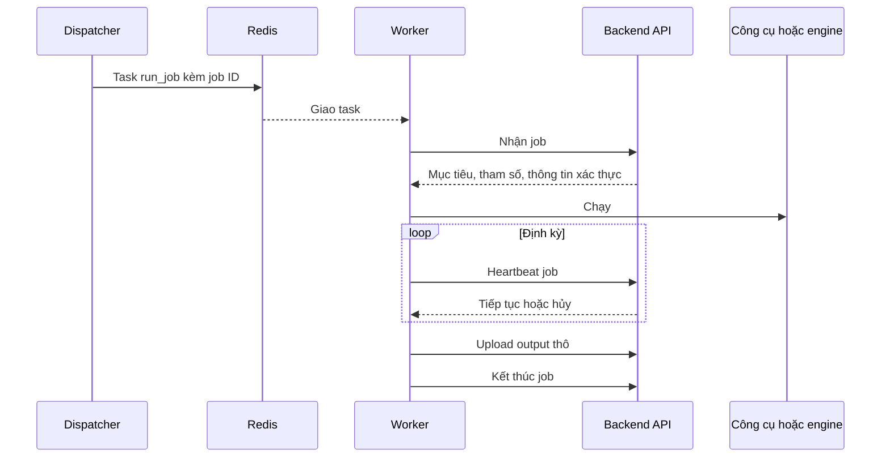

# Dịch vụ bên ngoài

> Phiên bản: 1.13 · Ngày: 2026-11-13 · Trạng thái: 🔵 Chờ duyệt
> Mục 13: Dịch vụ bên ngoài
> Liên quan: [modules.md](../architecture/modules.md), [system.md](../architecture/system.md), [database.md](../data/database.md), [authentication.md](../security/authentication.md), [schema.md](../data/schema.md), [tech-debt.md](../tech-debt.md)

## 📌 Đây là gì

- Contract worker ↔ backend: task Celery, endpoint worker gọi, cách upload output thô, heartbeat, hủy job.
- Cách runner gọi từng công cụ và engine, output thô mỗi tool module tạo ra và parser đọc gì từ đó.

## 🎯 Dùng để làm gì

- Mọi công cụ và engine đưa dữ liệu vào ReconOS qua một đường duy nhất: output thô (G1, G8).
- Thêm tool module chỉ cần thêm runner và parser theo cùng contract (G4).
- Thông tin xác thực không nằm trong Redis, worker chỉ nhận job đã kiểm tra scope (G5, G7).

## ⏰ Dùng khi nào

- Viết runner, parser, endpoint của contract worker. Thêm tool module. Cài engine server.
- Không dùng để tra API cho frontend: xem [api/architecture.md](../api/architecture.md).

## 📍 Ở đâu

- Model contract: `contracts/`. Runner: `workers/worker/runners/`. Parser: `backend/app/parser/`.
- Endpoint contract worker: `/api/v1/worker/`, chi tiết trong [openapi.yaml](../api/openapi.yaml). Cấu hình engine: S16, S17.

## ⚙️ Làm như thế nào

### Luồng một job trên worker

### Task Celery

| Mục | Quy định |
|---|---|
| Tên task | `worker.run_job` |
| Tham số | Chỉ `job_id`. ❌ Không gửi mục tiêu, tham số, thông tin xác thực qua Redis |
| Queue | `job.<tool module>`, ví dụ `job.nuclei`, `job.osmedeus-general` |
| Worker nghe | Các queue của tool module cài trên máy đó, khai báo trong cấu hình worker |
| Xác nhận | `acks_late`, mỗi lần nhận một task. Worker dừng đột ngột thì Celery giao lại task |
| Serializer | JSON. ❌ Không dùng pickle |

- Dispatcher gửi task vào queue theo `tool_module.name` của job, exchange trực tiếp cùng tên queue.
- Model task: `RunJobTask` trong `contracts/tasks.py`. Backend và workers kiểm tra cùng model.
- Worker giữ message chưa xác nhận ở key riêng `job.unacked`, `job.unacked_index`, `job.unacked_mutex`. Lõi dùng key mặc định `unacked`. Nhờ vậy worker không đưa được message vào queue của lõi khi Celery khôi phục message chưa xác nhận.
- `visibility_timeout` của worker là 24 giờ, dài hơn thời hạn chạy của mọi job.
- Worker tắt remote control, sự kiện task, gossip, mingle để chỉ dùng key của queue job: ACL ở `infras/redis/acl.conf`.

### Endpoint của contract worker

Mọi endpoint dùng token worker trong header `Authorization: Bearer`: [authentication.md](../security/authentication.md).

| Endpoint | Việc | Kết quả |
|---|---|---|
| `POST /api/v1/worker/heartbeat` | Báo worker còn hoạt động, kèm `tool_modules`, `tools`: mỗi phần tử `name`, `version` của công cụ đã cài, `cpu_percent` | Cập nhật `worker.last_heartbeat_at`, `worker.tool_modules`, `worker.tool_versions`, `worker.cpu_percent` |
| `POST /api/v1/worker/jobs/{job_id}/claim` | Nhận job | Job `dispatched` chuyển `running`, trả đặc tả job. Trạng thái khác: `409`, worker bỏ task |
| `POST /api/v1/worker/jobs/{job_id}/heartbeat` | Báo job còn chạy | `continue` hoặc `cancel` |
| `PUT /api/v1/worker/jobs/{job_id}/raw-outputs/{filename}` | Upload một file output thô | `201` lưu mới. `200` đã có cùng tên, không ghi đè |
| `POST /api/v1/worker/jobs/{job_id}/finish` | Kết thúc job sau khi upload xong, kèm `tool_version` của công cụ đã chạy | Job chuyển `completed` hoặc `failed`, ghi `job.tool_version` |
| `POST /api/v1/worker/logs` | Gửi log của worker theo lô | Ghi vào CSDL log: [logging.md](../../.claude/rules/logging.md) |

- Heartbeat chỉ chấp nhận job đang `running` trên đúng worker đã claim. Upload, finish chấp nhận job `running`, hoặc `cancelled` khi job bị hủy lúc đang chạy trên đúng worker đó và chưa nhận finish, để worker gửi phần output đã có. Sai thì trả `409`.
- Đặc tả job khi claim là model `JobSpec` trong `contracts/tasks.py`: `job_id`, `tool_module`, `target`, `params` đã kiểm tra, `timeout_minutes`, `heartbeat_seconds` lấy từ `job_heartbeat_seconds`, `proxy_url`, `engine` gồm `name`, `base_url`, `api_key`, `variables`, `settings` của engine. `engine` là `NULL` khi tool module không chạy trên engine, hoặc engine đang tắt, chưa có `base_url`, API key: runner finish `failed`. Worker không đọc CSDL nên nhận chu kỳ heartbeat qua claim.
- Body finish là `JobFinish` trong `contracts/job_status.py`: `status` nhận `completed`, `failed`, `cancelled`, kèm `status_reason`, `tool_version`. `cancelled` là worker xác nhận đã dừng theo lệnh hủy, job giữ trạng thái `cancelled`. Job đã `cancelled` mà worker gửi `completed` hoặc `failed` thì job vẫn giữ `cancelled`, chỉ ghi `tool_version`.
- Finish lặp lại sau khi job đã kết thúc với cùng trạng thái trên đúng worker trả `204`, không đổi gì. Job đã `cancelled` coi mọi finish của worker đó là đã nhận.
- Log theo lô: Backend API chỉ giữ `job_id` của bản ghi khi job đó do chính worker gửi log claim. `job_id` khác bị bỏ, `context` thêm `job_id_rejected`. `context` qua processor ẩn thông tin xác thực trước khi ghi `reconos_log`.
- Worker trực tuyến khi heartbeat worker mới hơn `job_heartbeat_timeout_minutes`. Dispatcher publish `worker.status_changed` khi worker mất heartbeat, Backend API publish khi worker gửi lại heartbeat.
- Heartbeat job trả `JobHeartbeatResponse` có `action`. Heartbeat worker là `WorkerHeartbeat`, log theo lô là `WorkerLogBatch` tối đa 1.000 bản ghi, cùng nằm trong `contracts/worker.py`. Worker gửi heartbeat worker theo `RECONOS_WORKER_HEARTBEAT_SECONDS`, gửi log mỗi 5 giây.
- Worker lấy phiên bản công cụ bằng lệnh phiên bản của từng công cụ khi khởi động, với engine lấy từ REST của engine. `version` là `NULL` khi công cụ không báo. `cpu_percent` là tải CPU trung bình của máy từ lần heartbeat trước.
- Proxy, API key, biến engine giải mã ở Backend API, chỉ đi qua HTTPS tới worker. ❌ Runner không ghi chúng ra log, file output.

### Upload output thô

- Body là nội dung file, gửi dạng stream. Header `Content-Type` theo định dạng file.
- Tên file do runner đặt, duy nhất trong job, khớp `RAW_OUTPUT_FILENAME_PATTERN` trong `contracts/raw_output.py`. ❌ Không chứa `/`, `..`.
- `Content-Type` theo đuôi file trong `CONTENT_TYPES` của `contracts/raw_output.py`, đuôi khác gửi `application/octet-stream`.
- Công cụ ghi file đơn: mỗi file một lần upload, gồm `stdout.txt`, `stderr.txt` của tiến trình con.
- Công cụ hoặc engine ghi cả thư mục: nén thư mục thành một gói, upload một lần.
- Upload lại cùng tên sau lỗi mạng: an toàn, không tạo bản trùng.
- Cách Backend API lưu và gửi task parse: [database.md](../data/database.md).

### Thử lại

| Việc | Thử lại | Hết lượt thử |
|---|---|---|
| Worker gọi Backend API: claim, heartbeat, upload, finish, gửi log | Tối đa 5 lần sau lần gọi đầu, chờ 1, 2, 4, 8, 16 giây, chỉ lỗi mạng và `5xx`. `429` chờ theo `Retry-After`, tối đa 300 giây | Dừng công cụ, ghi log `error`. Dispatcher chuyển job `failed` khi mất heartbeat |
| Runner gọi REST API của engine | Tối đa 5 lần, backoff lũy thừa, chỉ lỗi mạng và `5xx` | Job `failed` |
| Job `failed` | ❌ Không tự thử lại | Người dùng thử lại thủ công, tạo job mới |

- Thử lại an toàn vì upload cùng tên file, chuyển trạng thái job đều idempotent.
- Timeout mỗi lời gọi Backend API: kết nối 10 giây, đọc và ghi 60 giây cho mỗi đoạn dữ liệu. Upload gửi lại cả file ở mỗi lần thử.
- `409` không thử lại: claim `409` thì worker bỏ task, heartbeat, upload, finish `409` thì worker dừng job, không gọi finish.
- Lần gửi log cuối khi worker dừng chỉ gọi một lần.

### Heartbeat và hủy job

1. Worker gửi heartbeat của job theo chu kỳ trong [configuration.md](../ops/configuration.md).
2. Job đã chuyển `cancelled`: API trả `cancel`. Runner dừng công cụ, upload phần output đã có, gọi finish.
3. Quá thời hạn `tool_module.timeout_minutes`: runner dừng công cụ, gọi finish với trạng thái `failed`.
4. Job `running` không có heartbeat quá ngưỡng: dispatcher chuyển `failed`, lý do worker mất kết nối.

| Loại | Cách dừng |
|---|---|
| Công cụ | SIGTERM cho nhóm tiến trình của tiến trình con, quá 10 giây thì SIGKILL |
| Osmedeus | `DELETE /osm/api/runs/{run_id}` |
| Vigolium | `POST /api/scans/{scan_uuid}/stop` |

### Gọi công cụ

- Runner gọi công cụ bằng danh sách đối số, mỗi job một thư mục làm việc riêng: [coding-convention.md](../../.claude/rules/coding-convention.md).
- Mục tiêu ghi vào file trong thư mục làm việc, truyền đường dẫn file cho công cụ.
- Proxy ghi vào file quyền `0600` trong thư mục làm việc, xóa ngay khi công cụ dừng, không đặt trong danh sách đối số, không upload (G7).
- Tiến trình con chỉ nhận biến môi trường `PATH`, `HOME`, `LANG`, `LC_ALL`, `TZ`. Token worker, mật khẩu Redis không tới công cụ.
- Runner kiểm tra lại `params` bằng schema tham số của tool module trong `contracts/tool_modules/`. Không khớp thì finish `failed`, không chạy công cụ.
- Xóa thư mục làm việc sau khi finish thành công.

| Tool module | Nhóm | Output thô | Parser tạo |
|---|---|---|---|
| `nuclei` | Quét | `nuclei.jsonl`: mỗi dòng một kết quả | Finding |
| `gowitness` | Recon | `gowitness.jsonl` và từng file ảnh PNG | Screenshot, URL, công nghệ |
| `sqlmap` | Khai thác | `sqlmap.zip`: `results.csv` ở gốc gói, thư mục output của sqlmap trong `output/` | Finding |
| `dalfox` | Khai thác | `dalfox.jsonl`: dòng đầu `{"meta": ...}`, mỗi dòng sau một finding | Finding |

- gowitness 3.2.2 ghi JSONL, không dùng CSDL riêng của gowitness (G1). Mỗi dòng là một `Result`: `url`, `final_url`, `response_code`, `title`, `html`, `perception_hash`, `file_name`, `failed`, `failed_reason`, `probed_at`, `tls`, `technologies`, `headers`, `network`, `console`, `cookies`.
- `gowitness`: `scan file`, `--file`, `--chrome-path /usr/bin/chromium`, `--threads`, `--timeout`, `--delay`, `--chrome-window-x`, `--chrome-window-y`, `--screenshot-path`, `--screenshot-format png`, `--write-jsonl`, `--write-jsonl-file gowitness.jsonl`, `--log-scan-errors`. Tham số `threads`, `timeout`, `delay`, `window_width`, `window_height`. Phiên bản lấy từ `gowitness version`.
- Runner upload `stdout.txt`, `stderr.txt`, từng file PNG, rồi `gowitness.jsonl` sau cùng. File PNG có tên không khớp quy tắc tên file upload thì bỏ, ghi log `warning`. Job có proxy: runner finish `failed` vì gowitness chỉ nhận proxy trên dòng lệnh, nợ 66 trong [tech-debt.md](../tech-debt.md).
- Parser `gowitness` (`app/parser/gowitness.py`) chỉ đọc `gowitness.jsonl`, dòng tới 16 MiB. File khác của job ghi `no_parser` qua `Parser.accepts`. Parser service tìm ảnh theo `file_name` trong output thô cùng job, ghi `screenshot.raw_output_id`. HTML nằm trong `gowitness.jsonl` nên `html_raw_output_id` trỏ tới file này, parser chép HTML vào `screenshot.html`.
- URL tài sản là `url` gowitness được giao. `status_code`, `title` chỉ ghi vào URL tài sản khi `final_url` trùng `url`. Công nghệ gowitness nhận ra gắn vào URL tài sản. Cột jsonb, giới hạn độ dài: [schema.md](../data/schema.md). Bỏ giá trị cookie và giá trị `Set-Cookie` (G7).
- `failed` là `true` khi có response mà không chụp được ảnh: parser tạo screenshot `is_failed`. Lỗi điều hướng như DNS, timeout không có dòng JSONL, chỉ có trong `stderr.txt`: nợ 65.
- Trường trên lấy từ mã nguồn gowitness 3.2.2, chưa chạy thử trong image worker: nợ 42, 67.
- httpx ghi ngày hết hạn chứng chỉ TLS, parser ghi `url.tls_not_after`.
- Cờ dòng lệnh cụ thể nằm trong runner và schema tham số của tool module, kèm test.
- Parser `nuclei` (`app/parser/nuclei.py`) đọc mọi output thô của job nuclei. `stdout.txt` cùng JSONL với `nuclei.jsonl`, chuỗi khử trùng lặp gộp lại. Dòng không phải JSON của `stderr.txt` bị bỏ và đếm. Trường đọc, giới hạn độ dài, tài sản của finding: [schema.md](../data/schema.md).
- `sqlmap` 1.10.8: `-m` file mục tiêu, `--batch`, `--disable-coloring`, `--output-dir`, `--results-file`, `--level`, `--risk`, `--threads`, `--timeout`, `--retries`, `--delay`, `--technique`, `--dbms`, `--proxy-file`. Tham số `level`, `risk`, `technique`, `dbms`, `threads`, `timeout`, `retries`, `delay`. Phiên bản lấy từ `sqlmap --version`. Runner nén `results.csv` và thư mục `--output-dir` thành `sqlmap.zip` cả khi công cụ lỗi hoặc bị hủy, bỏ symlink, dừng job `failed` khi tổng dung lượng vượt 10 GiB.
- `dalfox` 3.2.4: `scan --input-type file`, `--config`, `--format jsonl`, `--output dalfox.jsonl`, `--silence`, `--no-color`, `--workers`, `--delay`, `--timeout`, `--rate-limit`, `--retries`, `--follow-redirects`, `--skip-mining`, `--skip-discovery`, `--deep-scan`, `--only-poc`. Tham số `workers`, `delay`, `timeout`, `rate`, `retries`, `follow_redirects`, `skip_mining`, `skip_discovery`, `deep_scan`, `only_poc`. Phiên bản lấy từ `dalfox --version`. dalfox v3 bỏ qua biến môi trường proxy, nên proxy đi qua file cấu hình JSON quyền `0600` truyền bằng `--config`, xóa khi công cụ dừng (G7). Mã thoát `1` là có finding, coi như `completed`. Mã `2` là lỗi.
- Tham số ngoài allowlist và lý do loại của từng công cụ ghi trong docstring của `contracts/tool_modules/<tool module>.py`, có test trong `contracts/tests/test_tool_modules.py`.
- Parser `sqlmap` (`app/parser/sqlmap.py`) chỉ mở mục `results.csv` của gói, mỗi dòng CSV `Target URL,Place,Parameter,Technique(s),Note(s)` một finding, severity `high`, `low` khi sqlmap ghi `false positive or unexploitable`. File không phải zip (`stdout.txt`, `stderr.txt`) không sinh gì. Parser `dalfox` (`app/parser/dalfox.py`) bỏ dòng `meta`, severity lấy từ `severity` của dalfox, thiếu thì theo hạng `V` `high`, `A`, `R` `medium`, `I` `info`. Finding của cả hai nằm trên URL bỏ query và fragment.
- `nuclei`: `-list`, `-jsonl`, `-output nuclei.jsonl`, `-silent`, `-no-color`, `-disable-update-check`, `-rate-limit`, `-concurrency`, `-timeout`, `-retries`, `-severity`, `-tags`, `-exclude-tags`, `-proxy`. Tham số `rate`, `threads`, `timeout`, `retries`, `severity`, `tags`, `exclude_tags`. Phiên bản lấy từ `nuclei -version`.

### Gọi engine

Engine chạy server riêng trong vùng worker. Runner gọi REST API của engine bằng `engine.base_url` và API key nhận khi claim.

| Bước | Osmedeus | Vigolium |
|---|---|---|
| Xác thực | Header `x-osm-api-key` | `Authorization: Bearer` |
| Phiên bản | `GET /server-info`, trường `version` | `GET /api/info`, trường `version` |
| Tạo lượt chạy | `POST /osm/api/runs` với `flow`, `target`, `params`, `timeout`. Response `202` có `run_uuid` | `POST /api/scans/run` với `targets`, `strategy`, `concurrency`, `rate_limit`, `scope_origin`, `scanning_max_duration`. Response `202` có `scan_uuid`, `409` khi engine đang chạy lượt quét khác |
| Theo dõi | `GET /osm/api/runs/{run_uuid}`, trường `data.status`: `pending`, `running`, `completed`, `failed`, `cancelled` | `GET /api/scans/{scan_uuid}`, trường `status` ở gốc object lượt quét. Runner vẫn đọc `data.status` nếu có |
| Dừng | `DELETE /osm/api/runs/{run_uuid}` | `POST /api/scans/{scan_uuid}/stop`, `409` là lượt quét đã dừng |
| Lấy kết quả | `GET /osm/api/snapshot-download/{workspace}`: zip cả workspace, `404` khi chưa có workspace. Sau đó `DELETE /osm/api/snapshots/{name}` | `GET /api/findings?scan_id=<scan_uuid>`, `limit` 500, `offset`, `sort=created_at`, `order=asc`, theo `has_more` |
| Output thô | `osmedeus.zip` | `vigolium-findings.jsonl` |

**Lượt chạy Osmedeus:**

- Mỗi mục tiêu của job một lượt chạy, chạy lần lượt theo thứ tự trong `job.target`.
- Cô lập workspace theo job: `params.space_name` bằng `reconos-<job_id>-<n>`, `n` là thứ tự mục tiêu tính từ 1. Osmedeus v5.1.2 dùng `space_name` làm tên workspace thay cho tên sinh từ mục tiêu. Hai job cùng mục tiêu không ghi chung workspace (G8).
- `params` gồm biến engine, rồi các khóa runner đặt sau cùng nên ghi đè biến trùng tên: `space_name`, `tactic` từ `engine.settings.scan_preset`, `threads_hold` khi tham số `threads` khác 0.
- `scan_preset` đổi thành `tactic`: `quick` thành `aggressive`, `balanced` thành `default`, `deep` thành `gently`. `tactic` quyết định số luồng mặc định của mọi công cụ trong workflow.
- `timeout` bằng thời gian còn lại của job tính theo phút, để engine tự dừng khi worker mất kết nối.
- Runner hỏi trạng thái lượt chạy và gửi heartbeat job mỗi `heartbeat_seconds`. Nhận `cancel` hoặc quá thời hạn: gọi `DELETE /osm/api/runs/{run_uuid}`, tải phần workspace đã có, không chạy mục tiêu còn lại.
- Job `completed` khi mọi lượt chạy `completed`. Có lượt `failed`: job `failed`, vẫn upload output thô.
- Phiên bản engine lấy từ `GET /server-info` khi bắt đầu job, gửi trong `tool_version` của finish.
- Mỗi lần tải, Osmedeus v5.1.2 giữ một bản zip `<workspace>_<unix>.zip` trong thư mục snapshot, tên nằm trong header `Content-Disposition`. Runner xóa bản zip này bằng `DELETE /osm/api/snapshots/{name}`, chỉ khi tên mở đầu bằng `<workspace>_`. Xóa lỗi chỉ ghi log `warning`, job giữ trạng thái.
- Workspace vẫn nằm trên engine server sau khi tải: v5.1.2 không có endpoint xóa workspace, `DELETE /osm/api/workspaces/{name}` trong tài liệu REST không có trong mã nguồn. Cách dọn ở [deployment.md](../ops/deployment.md).

**Lượt quét Vigolium:**

- Mỗi job một lượt quét gồm mọi mục tiêu trong `job.target`. Vigolium chỉ chạy một lượt quét mỗi lúc, nên tool module `vigolium` có `max_concurrency` 1.
- Body gồm tham số job: `strategy`, `threads` thành `concurrency`, `rate` thành `rate_limit`. Runner đặt thêm `scope_origin` là `strict` để lượt quét không chạm host khác mục tiêu (G5), `scanning_max_duration` bằng thời gian còn lại của job tính theo phút để engine tự dừng khi worker mất kết nối.
- Biến engine không gửi cho Vigolium: REST của lượt quét không có chỗ nhận biến.
- Engine trả `409` khi đang chạy lượt quét khác, kể cả lượt quét mở từ CLI hay giao diện của Vigolium: runner chờ, mỗi `heartbeat_seconds` gửi heartbeat job rồi gửi lại `POST /api/scans/run`. Nhận `cancel` thì job `cancelled`. Hết thời hạn job thì `failed` với lý do `engine stayed busy with another scan`. Lỗi `4xx` khác: job `failed` với lý do `engine refused the scan`, không thử lại.
- Runner hỏi trạng thái và gửi heartbeat job mỗi `heartbeat_seconds`. Trạng thái `pending`, `queued`, `starting`, `running`, `paused`, `cancelling` là chưa xong. Trạng thái khác kết thúc lượt hỏi, chỉ `completed` cho job `completed`.
- Nhận `cancel` hoặc quá thời hạn: gọi `stop`, chờ 30 giây cho engine dừng, rồi vẫn lấy finding đã có.
- Runner chép từng object trong `data` của `GET /api/findings` thành một dòng của `vigolium-findings.jsonl`, không đọc nội dung finding. Object có `scan_uuid` khác lượt quét của job bị bỏ, đếm vào log `engine_findings_foreign`: engine bỏ qua bộ lọc `scan_id` thì finding của program khác không lọt vào job.
- Dừng chép khi đủ 100.000 finding hoặc file vượt 2 GiB, ghi log `engine_findings_truncated`.
- Lấy finding lỗi: job `completed` chuyển `failed` với lý do `engine findings are unavailable`.
- Object finding của `GET /api/findings` không có `request`, `response`: hai trường này nằm ở bản ghi HTTP của Vigolium, parser để trống. Dạng object lấy từ job thật trên Vigolium v0.5.6, mẫu ở `backend/tests/fixtures/raw_output/vigolium/`.

**Gói `osmedeus.zip`:**

| Mục trong gói | Nội dung |
|---|---|
| `manifest.json` | `OsmedeusManifest` trong `contracts/tool_modules/osmedeus.py`: `tool_module`, `flow`, `engine_version`, `runs` |
| `runs[]` | `index` từ 1, `target`, `workspace`, `run_uuid`, `status` của Osmedeus hoặc `missing` khi không tạo được lượt chạy, `has_output` |
| `<index>/` | Nội dung workspace của lượt chạy thứ `index`, đường dẫn tương đối từ gốc workspace, trừ file nằm ngay ở gốc workspace. Không có thư mục khi `has_output` là `false` |

- Tên file trong workspace chứa tên workspace của lượt chạy, không chứa mục tiêu. Parser đọc tên workspace trong `manifest.json`.
- Runner chép lại từng mục từ zip của engine vào gói, bỏ mục có đường dẫn tuyệt đối hoặc `..`, dừng job `failed` khi tổng dung lượng giải nén vượt `PACKAGE_MAX_BYTES` 10 GiB.
- Runner bỏ mọi file nằm ngay ở gốc workspace: `run-state.json`, `run-completed.json`, `run-execution.log`, `run-console.log`, `run-workflow.yaml` của Osmedeus v5.1.2. Các file này chép lại toàn bộ `params` của lượt chạy, gồm biến engine, và `run-execution.log` còn chép `global_vars` trong cấu hình engine server (G7). Output của công cụ luôn nằm trong thư mục con.

| File trong `<index>/` | Module của flow | Nội dung |
|---|---|---|
| `subdomain/subdomain-<workspace>.txt` | `enum-subdomain` | Subdomain, mỗi dòng một tên. Không gồm chính mục tiêu |
| `probing/dns-<workspace>.txt` | `probe-dns` | Kết quả dnsx đã lọc, mỗi dòng một bản ghi |
| `probing/dns-json-<workspace>.txt` | `probe-dns` | JSONL của dnsx |
| `probing/http-<workspace>.txt` | `probe-dns` | URL HTTP sống, mỗi dòng một URL |
| `fingerprint/http-fingerprint-<workspace>.jsonl` | `recon-http-fp` | JSONL của httpx: URL, mã trạng thái, tiêu đề, công nghệ, IP |
| `ipspace/<workspace>-ip.txt` | `probe-dns` | IP lấy từ bản ghi A của `dns-json` |
| `portscan/open-ports-<workspace>.txt` | `probe-port` | Cổng mở dạng `ip:port`. Không có ở `domain-lite` |
| `portscan/http-port-fingerprint-<workspace>.jsonl` | `probe-port` | JSONL của httpx trên cổng mở. Không có ở `domain-lite` |
| `vulnscan/nuclei-jsonl-<workspace>.txt` | `scan-vuln` | JSONL của nuclei. Không có ở `domain-lite` |

- Đường dẫn trên lấy từ workflow cài trên engine server Osmedeus v5.1.2, kiểm chứng bằng job `osmedeus-domain-lite` thật ngày 2026-11-13. Workflow trên engine server bị sửa thì parser chỉ đọc file có mặt, file thiếu bỏ qua.
- Biến engine, API key không nằm trong gói: runner không ghi chúng ra file (G7).
- ReconOS chỉ dùng REST API. ❌ Không đọc CSDL của engine server (G1).

### Đọc cấu hình engine qua REST

Backend API, module `engine`, gọi REST của engine bằng `engine.base_url` và API key để phục vụ S16, S17. Kết quả không lưu, mỗi lần đọc gọi lại engine.

| Endpoint ReconOS | Engine | Việc |
|---|---|---|
| `POST /engines/{engine_id}/test` | Osmedeus | `GET /server-info` lấy `version`, rồi `GET /osm/api/workflows?limit=1` để kiểm tra API key vì `/server-info` không cần key |
| `POST /engines/{engine_id}/test` | Vigolium | `GET /api/info` có API key, lấy `version` |
| `GET /engines/{engine_id}/workflows`, `/workflows/{name}` | Osmedeus | `GET /osm/api/workflows`, `GET /osm/api/workflows/{name}?json=true`. Bỏ workflow `hidden`. `step_count` của flow là số module. `steps` của chi tiết gồm module rồi step. Body chi tiết không có `tags`, `description` của module: hai trường này để trống |
| `GET /engines/{engine_id}/modules` | Vigolium | `GET /api/modules` lấy module loại `active`, `passive`, `name` là `id`, `description` là `short_description`. `is_enabled` đọc từ `GET /api/config?filter=dynamic-assessment.enabled_modules`. Engine in danh sách theo dạng Go: `[all]`, `[a, b]`. `all` hoặc không có khóa là bật mọi module của loại đó |
| `PATCH /engines/{engine_id}/modules` | Vigolium | `POST /api/config` ghi `dynamic-assessment.enabled_modules.active_modules`, `passive_modules`: `all` khi bật đủ, nếu không thì danh sách `id` cách nhau bằng dấu phẩy. Tắt hết module của một loại: `422`, mã `module_required`, vì danh sách rỗng có thể bị engine hiểu là mặc định. Body trả `errors`: `502` |
| `POST /engines/{engine_id}/validate` | Vigolium | `GET /api/diagnostics`. Mỗi kiểm tra `error`, `warning` thành một dòng `issues`. `database` lỗi là `critical`, còn lại `advisory` vì lượt quét native không cần agent, trình duyệt. `ok` khi không có dòng `critical` |
| `POST /engines/{engine_id}/verify-model` | Vigolium | `POST /api/config` ghi `agent.olium.provider`, `agent.olium.model` và `custom_provider.model_id`, `custom_provider.base_url`, `agent.olium.llm_api_key` và `custom_provider.api_key` từ `engine.settings` và API key LLM, rồi đọc kiểm tra `agent` của `GET /api/diagnostics`. Chưa có `llm_provider`: `ok` là `false`, không gọi engine. Engine giữ cấu hình đã ghi. Kiểm tra `agent` chỉ đọc cấu hình, không gọi model: `ok` kèm dòng `advisory` báo model chưa được gọi thử |

- Endpoint trên kiểm chứng ngày 2026-11-13 trên Osmedeus v5.1.2 và Vigolium v0.5.6. Engine không có endpoint tương ứng thì ReconOS không dựng phần đó, endpoint ReconOS trả `404`.
- `POST /api/config` của Vigolium có hiệu lực ngay, không cần khởi động lại engine, kể cả mục `agent`. Engine ghi lại toàn bộ file `~/.vigolium/vigolium-configs.yaml` sau mỗi lần ghi, nên mọi comment trong file mất. Sao lưu file trước khi dùng PATCH module hoặc Verify Model lần đầu: [deployment.md](../ops/deployment.md).
- ❌ Không dựng cấu hình Database và Redis, Scope Defaults, Ingest Proxy, MITM, CA, bridge Burp và Caido, Hardening flags của engine (G1, G5).
- Backend gọi REST engine không thử lại, timeout 10 giây. Engine không trả lời, từ chối API key hoặc trả body sai dạng: `502 engine_unavailable`. Kiểm tra thất bại vẫn ghi `last_test_ok` là `false` qua session độc lập.

### Tool module của engine

| Tool module | Flow | Công cụ bên trong | Nhóm |
|---|---|---|---|
| `osmedeus-domain-lite` | `domain-lite` | subfinder, dnsx, httpx | Recon |
| `osmedeus-general` | `general` | subfinder, dnsx, httpx, rustscan, nmap, nuclei | Quét |
| `osmedeus-domain-extensive` | `domain-extensive` | Như `general`, thêm DNS brute force, quét đủ dải cổng | Quét |
| `vigolium` | Quét mặc định | Module của Vigolium | Quét |

- Kiểm tra tên flow bằng `osmedeus workflow list` trên engine server khi thêm tool module.
- Tool module `osmedeus-<flow>` khai báo trong `contracts/tool_modules/osmedeus_<flow>.py` bằng `osmedeus_spec`, runner trong `workers/worker/runners/osmedeus_<flow>.py` kế thừa `OsmedeusRunner`. Tham số duy nhất: `threads` từ 0 đến 100, 0 giữ số luồng của `tactic`.
- Thời hạn mặc định do migration ghi: `domain-lite` 240 phút, `general` 720 phút, `domain-extensive` 1.200 phút.
- Parser Osmedeus đọc gói `osmedeus.zip` theo mục Gói `osmedeus.zip` ở trên. Mỗi workflow một file parser `osmedeus_<workflow>.py` kế thừa lớp chung `app/parser/osmedeus.py`.
- Parser chỉ mở mục có tên đúng `<index>/<đường dẫn>` lấy từ `manifest.json`, không giải nén ra đĩa. Mục khác trong gói, kể cả mục có đường dẫn tuyệt đối hoặc `..`, không bao giờ được mở.
- `probing/dns-<workspace>.txt` không đọc: cùng nội dung với `dns-json`. `vulnscan/nuclei-jsonl-<workspace>.txt` đọc bằng bộ đọc dòng của parser `nuclei`, finding mang `dedup_key` mở đầu bằng tên tool module Osmedeus.
- Dòng sai định dạng bị bỏ và đếm vào log `parse_completed`. Gói không phải zip, thiếu hoặc sai `manifest.json`: `parse_status = failed`, không thử lại: [system.md](../architecture/system.md).
- Ảnh chụp do httpx trong Osmedeus tạo chỉ nằm trong output thô. Parser không tạo `screenshot` từ ảnh này.
- Tool module `vigolium` khai báo trong `contracts/tool_modules/vigolium.py`, runner `workers/worker/runners/vigolium.py`. Tham số: `strategy` là `lite`, `balanced`, `deep`, mặc định `balanced`. `threads` từ 1 đến 100, mặc định 25. `rate` từ 1 đến 1.000 request mỗi giây, mặc định 100. Thời hạn mặc định do migration `0010` ghi: 480 phút.
- Runner Osmedeus và Vigolium dùng chung client REST `workers/worker/runners/engine_client.py`: thử lại lỗi mạng và `5xx` theo số lần ở mục Thử lại.
- Parser `vigolium` (`app/parser/vigolium.py`) đọc mỗi dòng một finding. `template_id` là `module_id`, `name` là `module_name`, `matched_at` là phần tử đầu của `matched_at`, tài sản lấy từ `matched_at` như parser `nuclei`. CVE lấy từ tag dạng `cve-<năm>-<số>`. Dòng thiếu `module_id` hoặc `matched_at` bị bỏ và đếm.

### Chuỗi khử trùng lặp

| Tool module | Thành phần `dedup_key` |
|---|---|
| `nuclei`, phần nuclei trong Osmedeus | `template-id`, `matched-at` |
| `vigolium` | `finding_hash` của Vigolium. Dòng không có `finding_hash`: `module_id`, `severity`, `matched_at` đầu tiên, các trường Vigolium dùng để gộp finding trùng |
| `dalfox` | Loại lỗ hổng, URL, tham số bị ảnh hưởng |
| `sqlmap` | URL, tham số bị ảnh hưởng, kỹ thuật |
| `vigolium` | `finding_hash` của Vigolium |
| `dalfox` | Loại lỗ hổng là `inject_type`, URL bỏ query, tham số bị ảnh hưởng |
| `sqlmap` | URL như trong `results.csv`, vị trí kèm tham số bị ảnh hưởng dạng `GET:id`, chuỗi chữ cái kỹ thuật |

- `dedup_key` bắt đầu bằng tên tool module: [database.md](../data/database.md).
